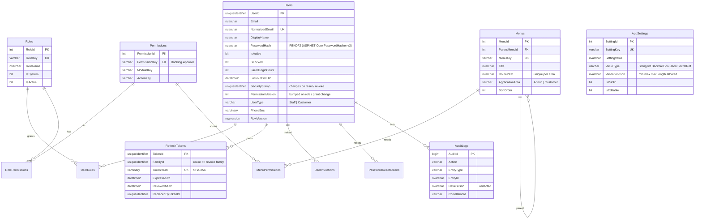
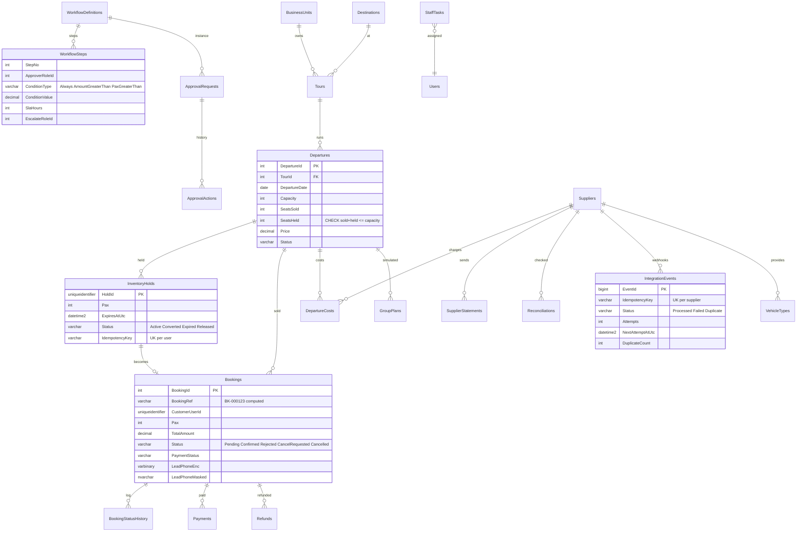
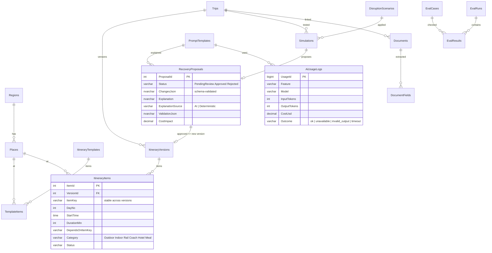

# Database design (SQL Server)

There are two separate databases that share the same admin schema:

| App | Database | Purpose |
|---|---|---|
| A · Tour Operations ERP (`tour-operations`) | `SanpuErp` | reservations, inventory, suppliers, approvals, finance, group simulation |
| B · AI Operations Copilot (`ai-travel`) | `SanpuAiOps` | trips, itinerary versions, disruptions, AI proposals, documents, evaluations |

The admin schema SQL lives once in `shared/database` and runs against each database, so the two apps share the scripts but never share data.

Conventions:
- Every timestamp is UTC (`datetime2(3)`, suffix `Utc`).
- Mutable rows carry `RowVersion rowversion`. Updates send it back and the proc raises `50009 concurrency_conflict` if it has changed.
- Stored procedures report business errors with `THROW 500xx, '<code>', 1`, and the API maps each one to a stable ProblemDetails code.
- Demo rows have `IsDemo = 1`, and the UI shows a **DEMO / FICTIONAL** badge on them.
- Phone and passport numbers are stored as `varbinary` with AES-256-GCM app-layer encryption (key from the environment), next to a masked display copy.

## 1. Admin core (both databases)



Other tables: `ContentTemplates` (key + locale, Content or Notification), `DevOutbox` (the local test inbox for invitation and reset emails while SMTP is off), and `SchemaVersions` (the migration ledger).

Rules enforced in SQL:
- `AuditLogs` is insert-only. An `INSTEAD OF UPDATE, DELETE` trigger raises an error.
- In `usp_Admin_Menus_Upsert`, a recursive CTE refuses a parent that is the menu itself or one of its descendants (`50010 menu_cycle`). Delete refuses a menu that still has children (`50011 has_children`).
- `usp_Admin_Users_UpdateStatus` and `usp_Admin_Roles_SetPermissions` refuse to deactivate the last active `system_admin` or to remove its admin grants (`50020 last_admin`).
- Changing a role's permissions bumps `PermissionVersion` for every member. The API caches each user's permission set by `(UserId, PermissionVersion)`, so the change applies on that user's next request.

## 2. App A · ERP (`SanpuErp`)



Also: `VehicleTypes`, `CostAssumptions` (guide, meal and hotel costs per pax), `RetentionPolicies`.

Concurrency for the last seat: `usp_Booking_CreateHold` reads the departure `WITH (UPDLOCK, HOLDLOCK)` inside a `SERIALIZABLE` transaction. If two buyers race for the final seat, the second one waits on the lock, sees no seats left and gets `50030 insufficient_capacity`. Expired holds are released in the same transaction before seats are counted.

Booking state machine (Domain `BookingStateMachine` plus a SQL check in `usp_Booking_Decide`):

```
Pending --approve--> Confirmed --cancel--> Cancelled
Pending --reject--> Rejected
Confirmed --customer request--> CancelRequested --cancel--> Cancelled
Pending --customer withdraw--> Cancelled
```

## 3. App B · AI Copilot (`SanpuAiOps`)



Also: `TravelConstraints` (constraint rules stored as data), `DocumentFields` (value, confidence, method, source span), and `EvalCases`/`EvalRuns`/`EvalResults`.

## 4. Stored procedure catalog

| Area | Procedures |
|---|---|
| Auth | `usp_Auth_GetUserByEmail`, `usp_Auth_RecordLoginResult`, `usp_Auth_GetUserSecurityState`, `usp_Auth_GetUserPermissions`, `usp_Auth_CreateRefreshToken`, `usp_Auth_RotateRefreshToken`, `usp_Auth_RevokeRefreshToken`, `usp_Auth_RevokeSessions`, `usp_Auth_CreatePasswordReset`, `usp_Auth_ConsumePasswordReset`, `usp_Auth_GetInvitation`, `usp_Auth_AcceptInvitation`, `usp_Auth_ChangePassword`, `usp_Auth_RegisterCustomer` |
| Admin | `usp_Admin_Dashboard`, `usp_Admin_Users_List/Get/Create/AssignRoles/UpdateStatus`, `usp_Admin_Roles_List/Upsert/SetPermissions`, `usp_Admin_Permissions_List/Update`, `usp_Admin_Menus_GetTree/Upsert/SetPermissions/Move/Delete`, `usp_Admin_Settings_Get/Upsert`, `usp_Admin_Content_List/Upsert`, `usp_Navigation_ForUser`, `usp_Audit_Write`, `usp_Audit_Search` |
| ERP | `usp_Catalog_SearchTours`, `usp_Catalog_GetTour`, `usp_Booking_CreateHold`, `usp_Booking_CreateFromHold`, `usp_Booking_Decide`, `usp_Booking_Cancel`, `usp_Booking_RequestCancel`, `usp_Booking_ListForCustomer`, `usp_Ops_*` (business units, suppliers, tours, departures, bookings, dashboard), `usp_Approval_Inbox/Act`, `usp_Workflow_List/SaveVersion`, `usp_Finance_RecordPayment/CreateRefund`, `usp_Integration_IngestEvent/MarkResult/List`, `usp_Recon_Run/Resolve/List`, `usp_GroupSim_Inputs/Save/Decide`, `usp_Tasks_List/Update`, `usp_Privacy_*` |
| AI | `usp_Trip_*`, `usp_Itinerary_SaveVersion/GetVersion`, `usp_Scenario_*`, `usp_Sim_Inputs/Save`, `usp_Proposal_Save/Get/Decide`, `usp_Search_Trips`, `usp_Doc_*`, `usp_Prompt_*`, `usp_AiUsage_Write/List`, `usp_Eval_*`, `usp_AiOps_Dashboard` |

The exact column definitions are in the migration scripts under `sanpu-workspace/*/database/migrations`. Those scripts are the source of truth, and this page is the overview.
