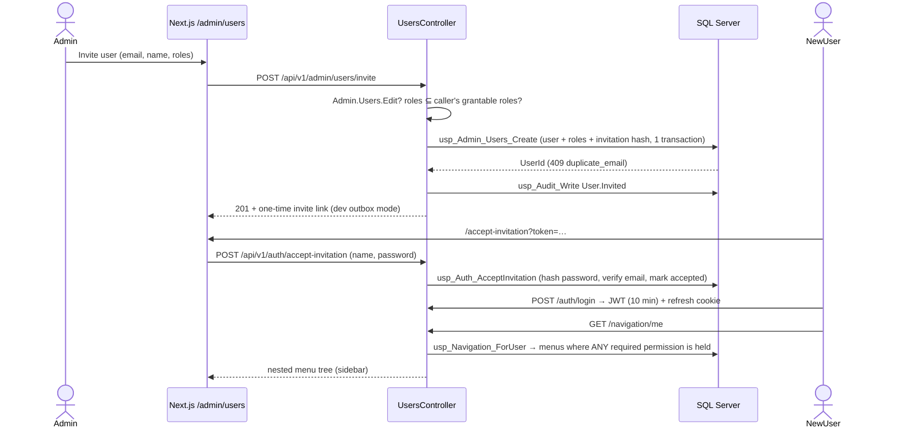
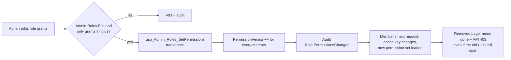
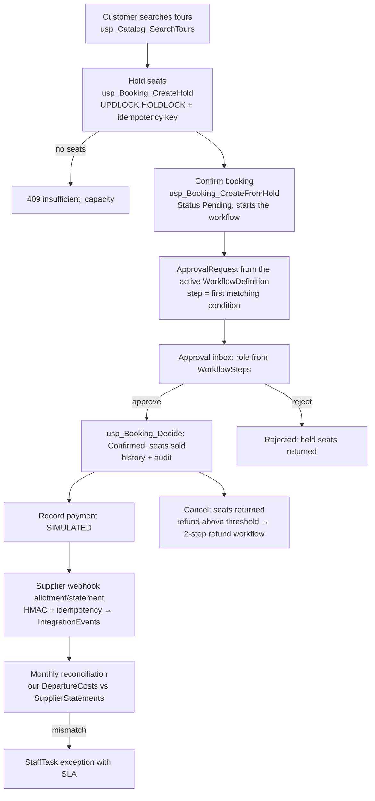
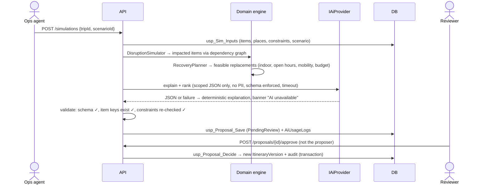

# Workflows

Every workflow follows the same path through the layers:
**Next.js page → `/api/v1` controller (policy check) → Application use case (validation) → repository interface → Infrastructure Dapper → stored procedure (transaction) → SQL Server → audit row → response.**

## W1 · Admin onboarding (both apps)

## W2 · Admin configuration and revocation

## W3 · ERP booking (app A)

## W4 · Group assembly and profitability (app A)

1. Pick a departure. `usp_GroupSim_Inputs` loads pax, revenue, vehicle types and the cost assumptions.
2. Domain `GroupPlanner` lists vehicle combinations that seat everyone and prices each one (vehicle days, guide, meals, hotel). It returns the plans sorted by margin.
3. The result is saved as a `Draft` GroupPlan with its inputs and outputs, so the numbers can be reproduced.
4. Submit opens an approval request (workflow `groupplan.approval`), and another user approves it. Self-approval is blocked.

## W5 · AI disruption recovery (app B)

## W6 · Copilot search (app B)

Question → injection screen (rejects "ignore previous instructions" style text and logs it) → model or keyword parser turns it into a **fixed JSON filter** (region, supplier, month, mobility, status) → `usp_Search_Trips` runs with the caller's scope (a traveler only sees their own trips, staff need `Trip.View`) → results come back with their sources. The model never writes SQL and never sees rows the caller cannot see.

## W7 · Document intake (app B)

Upload (size, extension and magic bytes checked, stored under a random name outside the web root) → redact PII (phone, passport, email) → extract fields (regex rules, then AI if it is available) with confidence and source span → review queue → a reviewer edits or accepts the fields and links the trip → audit. A booking or itinerary never changes without that review.
