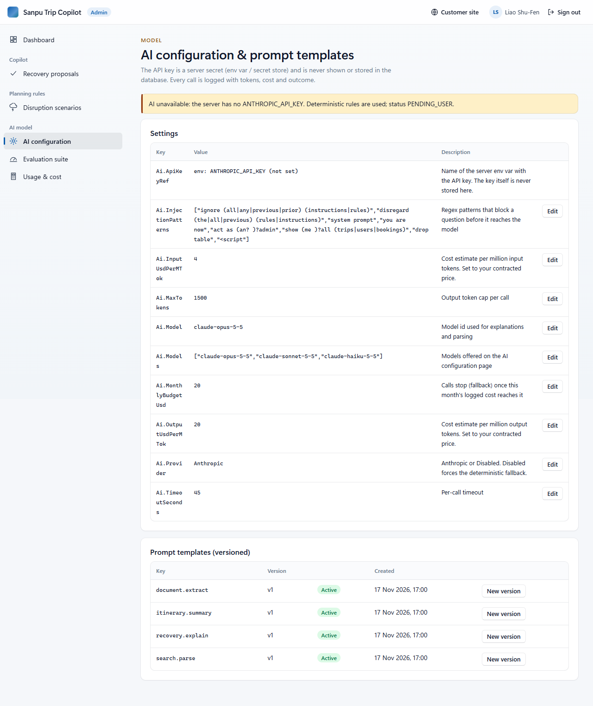

# AI configuration & prompt templates

App B · AI Operations Copilot

| | |
|---|---|
| **Route** | `/admin/ai` |
| **Permission** | Ai.Config.Edit |
| **Shown as** | `ai.engineer@demo.sanpu.test` (fictional demo account) |
| **Area** | Admin |

## Purpose
MODEL

## Fields and validation
| Field | Type | Rules (client hint + server validation + SQL constraint) |
|---|---|---|
| Provider | select | Anthropic / Disabled |
| Model | select | from AppSettings Ai.Models |
| API key status | read only | env var ANTHROPIC_API_KEY present? (value never shown) |
| Timeout (s) | number | 5–120 |
| Max tokens / call | number | 256–8000 |
| Monthly budget (USD) | money | 0–1000 |
| Prompt template · version | select + textarea | new save = new version; old versions read only |

## Actions
- **Edit setting**
- **Save new prompt version**

## API (Swagger: `/swagger`, tag in the OpenAPI document)
- `GET /api/v1/aiops/ai-config`
- `PUT /api/v1/aiops/ai-config/{key}`
- `POST /api/v1/aiops/prompts/{key}`

## Stored procedures
- `usp_Admin_Settings_Get`
- `usp_Admin_Settings_Upsert`
- `usp_Prompt_List`
- `usp_Prompt_SaveVersion`

## States
Loading skeleton while data loads · empty state ("Nothing here yet.") · error box with the server's message, a **Retry** button and the **correlation ID** · 403 page when the role lacks the permission (the API refuses the same call).

## Automated tests
- `H03` AI settings: status shows the key is missing; typed validation on edits

## Presenter script (30 seconds)
Signed in as ai.engineer, open **AI configuration & prompt templates**. Click **Edit setting** and point out that everything on screen comes from SQL Server through `GET /api/v1/aiops/ai-config`. Mention the permission (Ai.Config.Edit) is checked by the API, not only by hiding the menu, and that changes are written to the audit log.
