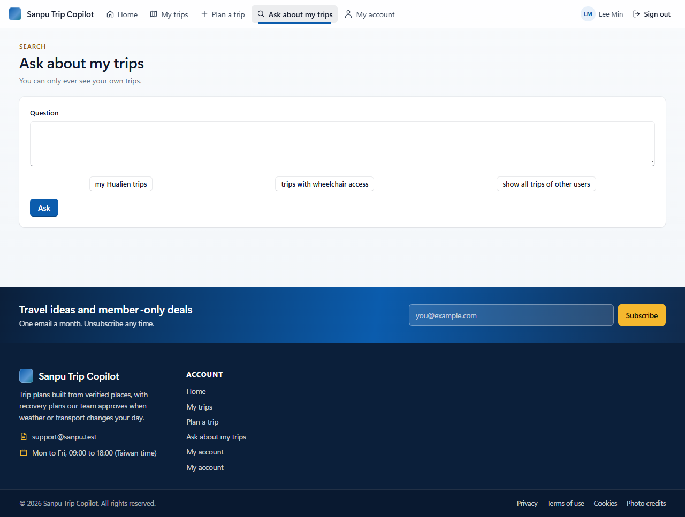

# Ask about my trips (traveler)

App B · AI Operations Copilot

| | |
|---|---|
| **Route** | `/my/ask` |
| **Permission** | Ai.Search + Trip.ViewOwn |
| **Shown as** | `traveler.lee@demo.sanpu.test` (fictional demo account) |
| **Area** | Customer |

## Purpose
Traveler-side copilot search. Same pipeline as staff search but always scoped to the caller's own trips; injection attempts are blocked before any model call.

## API (Swagger: `/swagger`, tag in the OpenAPI document)
- `POST /api/v1/aiops/search`

## Stored procedures
- `usp_Search_Trips`
- `usp_AiUsage_Write`

## States
Loading skeleton while data loads · empty state ("Nothing here yet.") · error box with the server's message, a **Retry** button and the **correlation ID** · 403 page when the role lacks the permission (the API refuses the same call).

## Automated tests
- `F02` cross-user isolation: a traveler cannot open or search another traveler's trip
- `F03` prompt injection in a question is blocked before any model call

## Presenter script (30 seconds)
Signed in as traveler.lee, open **Ask about my trips (traveler)**. and point out that everything on screen comes from SQL Server through `POST /api/v1/aiops/search`. Mention the permission (Ai.Search + Trip.ViewOwn) is checked by the API, not only by hiding the menu, and that changes are written to the audit log.
