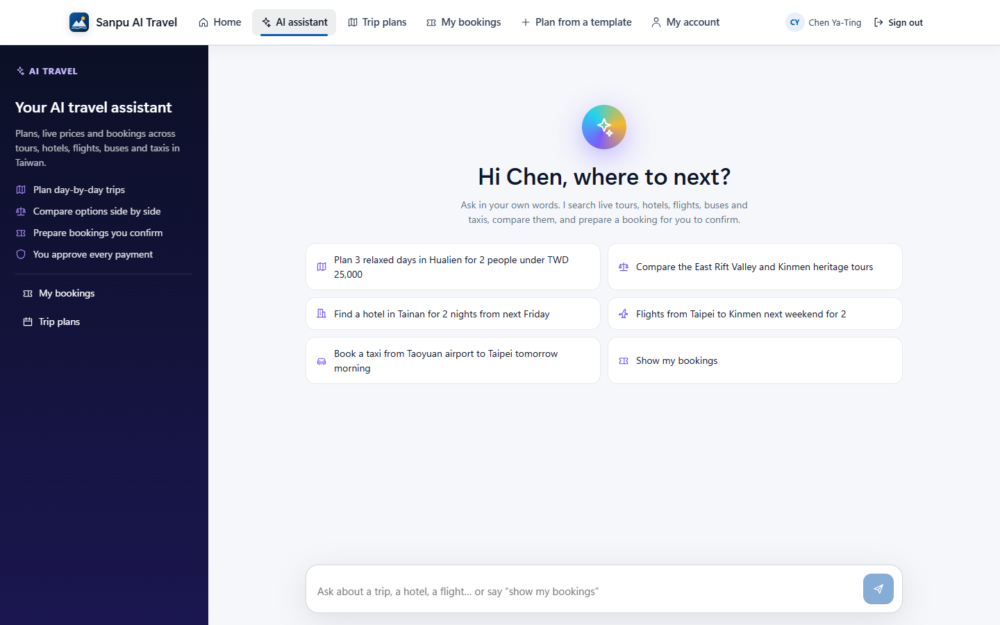

# AI assistant (chat)

App B · Sanpu AI Travel

| | |
|---|---|
| **Route** | `/assistant` |
| **Permission** |  |
| **Shown as** | `traveler.chen@demo.sanpu.test` (fictional demo account) |
| **Area** | Customer |

## Purpose
Conversation with tool use over Sanpu Travel's live catalog: tours, hotels, flights, buses, taxis, comparisons, plans and bookings prepared for the traveler to confirm. Book this on a card prepares a booking without AI. Gemini, ChatGPT and Claude in order, with keyword search when no AI is available.

## API (Swagger: `/swagger`, tag in the OpenAPI document)
- `POST /api/v1/assistant/chat {messages}`
- `POST /api/v1/assistant/prepare {kind, code, date, end_date, travelers, departure_id}`

## Stored procedures
- `usp_Reservation_Prepare`
- `usp_AiUsage_Write`

## States
Loading skeleton while data loads · empty state ("Nothing here yet.") · error box with the server's message, a **Retry** button and the **correlation ID** · 403 page when the role lacks the permission (the API refuses the same call).

## Automated tests
- Covered by the screenshot run (`tests/e2e/screens.spec.ts`) and manual checklist; no dedicated functional test yet.

## Presenter script (30 seconds)
Signed in as traveler.chen, open **AI assistant (chat)**. and point out that everything on screen comes from SQL Server through `POST /api/v1/assistant/chat`. Mention the permission () is checked by the API, not only by hiding the menu, and that changes are written to the audit log.
