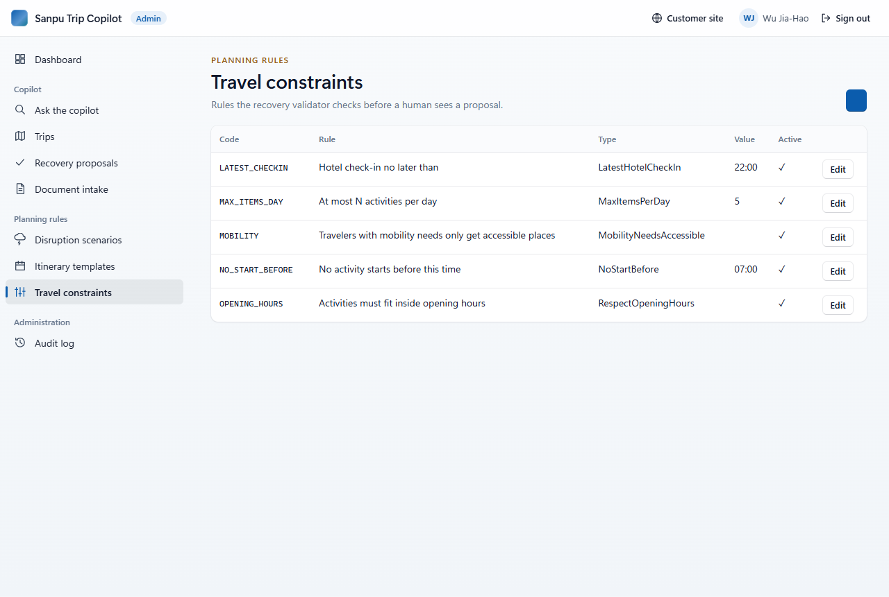

# Travel constraints

App B · AI Operations Copilot

| | |
|---|---|
| **Route** | `/admin/constraints` |
| **Permission** | Constraint.Edit |
| **Shown as** | `supervisor@demo.sanpu.test` (fictional demo account) |
| **Area** | Admin |

## Purpose
Rules the proposal validator checks (max items per day, earliest start, latest hotel check-in, accessibility, opening hours).

## API (Swagger: `/swagger`, tag in the OpenAPI document)
- `GET /api/v1/aiops/constraints`
- `PUT /api/v1/aiops/constraints/{id}`

## Stored procedures
- `usp_Constraints_List`
- `usp_Constraints_Update`

## States
Loading skeleton while data loads · empty state ("Nothing here yet.") · error box with the server's message, a **Retry** button and the **correlation ID** · 403 page when the role lacks the permission (the API refuses the same call).

## Automated tests
- Covered by the screenshot run (`tests/e2e/screens.spec.ts`) and manual checklist; no dedicated functional test yet.

## Presenter script (30 seconds)
Signed in as supervisor, open **Travel constraints**. and point out that everything on screen comes from SQL Server through `GET /api/v1/aiops/constraints`. Mention the permission (Constraint.Edit) is checked by the API, not only by hiding the menu, and that changes are written to the audit log.
