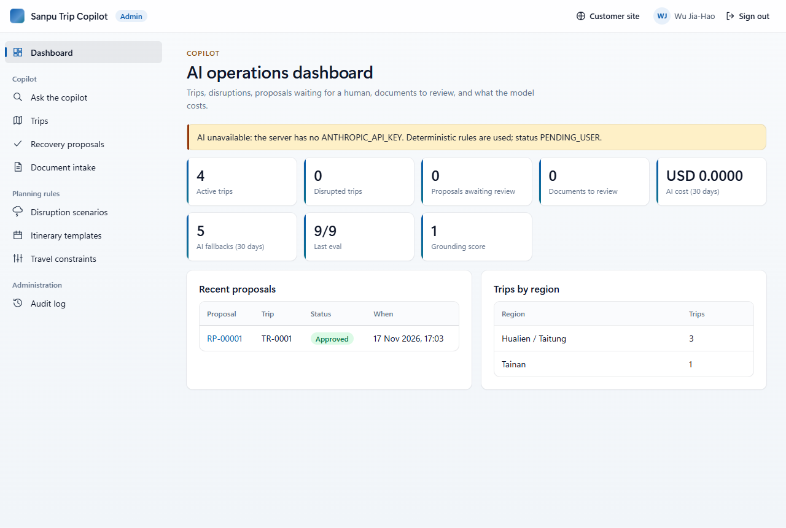

# AI operations dashboard

App B · AI Operations Copilot

| | |
|---|---|
| **Route** | `/admin` |
| **Permission** | AiOps.Dashboard.View |
| **Shown as** | `supervisor@demo.sanpu.test` (fictional demo account) |
| **Area** | Admin |

## Purpose
COPILOT

## Actions
- **Open proposals**

## API (Swagger: `/swagger`, tag in the OpenAPI document)
- `GET /api/v1/aiops/dashboard`

## Stored procedures
- `usp_AiOps_Dashboard`

## States
Loading skeleton while data loads · empty state ("Nothing here yet.") · error box with the server's message, a **Retry** button and the **correlation ID** · 403 page when the role lacks the permission (the API refuses the same call).

## Automated tests
- `H04` responsive copilot pages on phone width

## Presenter script (30 seconds)
Signed in as supervisor, open **AI operations dashboard**. Click **Open proposals** and point out that everything on screen comes from SQL Server through `GET /api/v1/aiops/dashboard`. Mention the permission (AiOps.Dashboard.View) is checked by the API, not only by hiding the menu, and that changes are written to the audit log.
