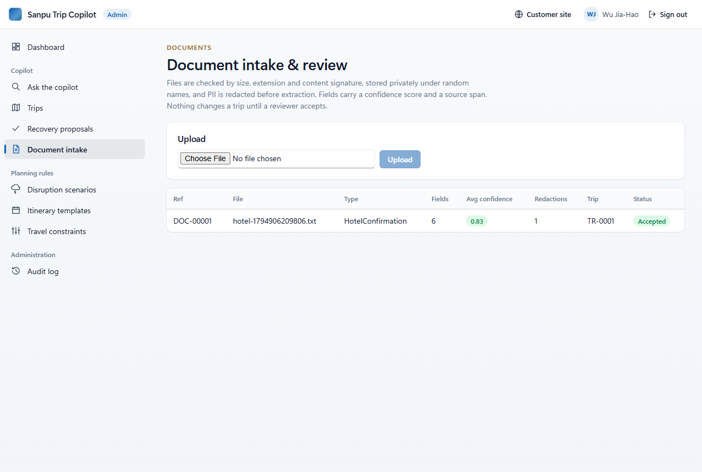

# Document intake & review

App B · Sanpu AI Travel

| | |
|---|---|
| **Route** | `/admin/documents` |
| **Permission** | Document.Review |
| **Shown as** | `supervisor@demo.sanpu.test` (fictional demo account) |
| **Area** | Admin |

## Purpose
PII redacted before extraction; provenance (span + method) kept for each field

## Fields and validation
| Field | Type | Rules (client hint + server validation + SQL constraint) |
|---|---|---|
| Upload | file | .txt .pdf .png · ≤ 2 MB · checked by magic bytes · stored under a random name |
| Extracted field · value | text | editable by reviewer |
| Link to trip | select | required to accept |

## Actions
- **Upload**
- **Accept fields**
- **Reject document**

## API (Swagger: `/swagger`, tag in the OpenAPI document)
- `POST /api/v1/aiops/documents (multipart)`
- `POST /api/v1/aiops/documents/{id}/review`

## Stored procedures
- `usp_Doc_Create (document + extracted fields in one transaction)`
- `usp_Doc_List`
- `usp_Doc_Get`
- `usp_Doc_Review`

## Rules, audit and security effects
- PII redacted before extraction; provenance (span + method) kept for each field

## States
Loading skeleton while data loads · empty state ("Nothing here yet.") · error box with the server's message, a **Retry** button and the **correlation ID** · 403 page when the role lacks the permission (the API refuses the same call).

## Automated tests
- `H01` document intake: PII redacted, fields extracted with confidence, reviewer accepts

## Presenter script (30 seconds)
Signed in as supervisor, open **Document intake & review**. Click **Upload** and point out that everything on screen comes from SQL Server through `POST /api/v1/aiops/documents`. Mention the permission (Document.Review) is checked by the API, not only by hiding the menu, and that changes are written to the audit log.
