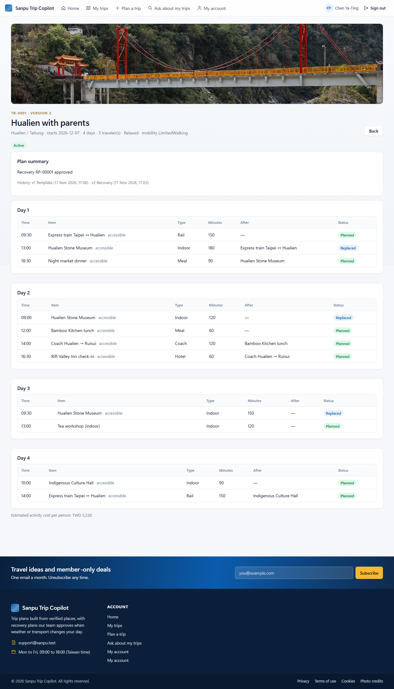

# Itinerary view

App B · Sanpu AI Travel

| | |
|---|---|
| **Route** | `/trips/1` |
| **Permission** | Trip.ViewOwn |
| **Shown as** | `traveler.chen@demo.sanpu.test` (fictional demo account) |
| **Area** | Customer |

## Purpose
ITINERARY

## API (Swagger: `/swagger`, tag in the OpenAPI document)
- `GET /api/v1/my/trips/{id}`

## Stored procedures
- `usp_Trip_Get (with traveler scope)`

## States
Loading skeleton while data loads · empty state ("Nothing here yet.") · error box with the server's message, a **Retry** button and the **correlation ID** · 403 page when the role lacks the permission (the API refuses the same call).

## Automated tests
- `G01` simulate typhoon → proposal → proposer cannot approve → supervisor approves → traveler sees v2
- `F02` cross-user isolation: a traveler cannot open or search another traveler's trip

## Presenter script (30 seconds)
Signed in as traveler.chen, open **Itinerary view**. and point out that everything on screen comes from SQL Server through `GET /api/v1/my/trips/{id}`. Mention the permission (Trip.ViewOwn) is checked by the API, not only by hiding the menu, and that changes are written to the audit log.
