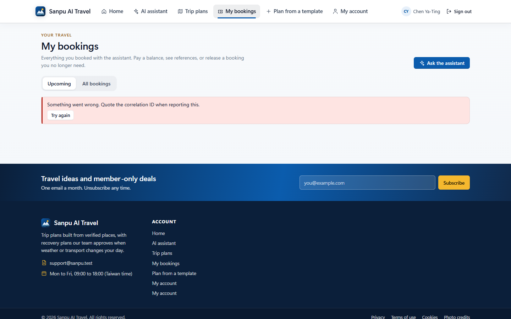

# My bookings (AI Travel)

App B · Sanpu AI Travel

| | |
|---|---|
| **Route** | `/my/bookings` |
| **Permission** |  |
| **Shown as** | `traveler.chen@demo.sanpu.test` (fictional demo account) |
| **Area** | Customer |

## Purpose
Bookings made with the assistant: pay a deposit, the balance or in full (sandbox), cancel; each step sends an email.

## API (Swagger: `/swagger`, tag in the OpenAPI document)
- `GET /api/v1/my/bookings`
- `POST /api/v1/my/bookings/{id}/pay {mode}`
- `POST /api/v1/my/bookings/{id}/cancel`

## Stored procedures
- `usp_Reservation_ListForTraveler`
- `usp_Reservation_Pay`
- `usp_Reservation_Cancel`

## States
Loading skeleton while data loads · empty state ("Nothing here yet.") · error box with the server's message, a **Retry** button and the **correlation ID** · 403 page when the role lacks the permission (the API refuses the same call).

## Automated tests
- Covered by the screenshot run (`tests/e2e/screens.spec.ts`) and manual checklist; no dedicated functional test yet.

## Presenter script (30 seconds)
Signed in as traveler.chen, open **My bookings (AI Travel)**. and point out that everything on screen comes from SQL Server through `GET /api/v1/my/bookings`. Mention the permission () is checked by the API, not only by hiding the menu, and that changes are written to the audit log.
