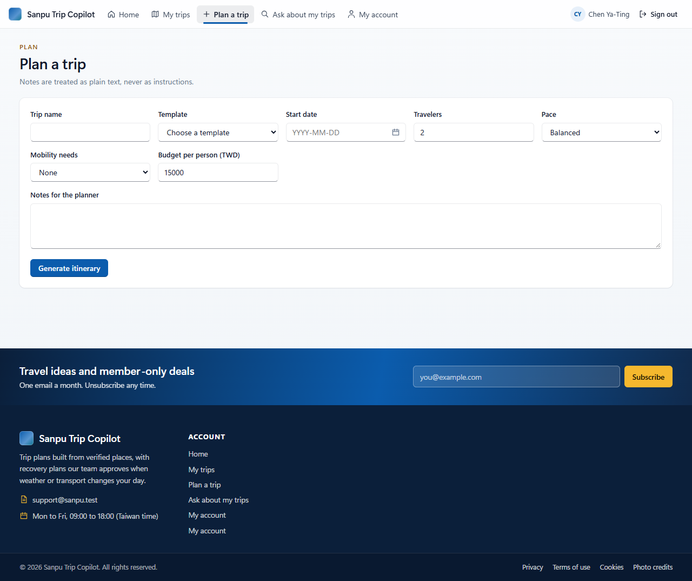

# Plan a trip (preferences)

App B · Sanpu AI Travel

| | |
|---|---|
| **Route** | `/trips/new` |
| **Permission** | Trip.Create |
| **Shown as** | `traveler.chen@demo.sanpu.test` (fictional demo account) |
| **Area** | Customer |

## Purpose
If no AI key: banner "AI unavailable, built from template rules" and the plan still works

## Fields and validation
| Field | Type | Rules (client hint + server validation + SQL constraint) |
|---|---|---|
| Trip name | text | required · max 120 |
| Start date | date | required · ≥ today |
| Days | number | 1–14 |
| Template | select | from ItineraryTemplates |
| Travelers | number | 1–20 |
| Pace | radio | Relaxed / Balanced / Packed |
| Mobility needs | checkbox list | Wheelchair / Limited walking / None |
| Budget per person (TWD) | money | 1000–500000 |
| Notes for the planner | textarea | max 1000 · treated as untrusted text |

## Actions
- **Generate itinerary**

## API (Swagger: `/swagger`, tag in the OpenAPI document)
- `POST /api/v1/trips → 201`
- `(generation runs inside POST /trips: template rules build version 1; AI may only write the summary)`

## Stored procedures
- `usp_Trip_Create`
- `usp_Itinerary_SaveVersion`

## Rules, audit and security effects
- If no AI key: banner "AI unavailable, built from template rules" and the plan still works

## States
Loading skeleton while data loads · empty state ("Nothing here yet.") · error box with the server's message, a **Retry** button and the **correlation ID** · 403 page when the role lacks the permission (the API refuses the same call).

## Automated tests
- `F01` plan a trip: itinerary built from the DB template, mobility rules applied

## Presenter script (30 seconds)
Signed in as traveler.chen, open **Plan a trip (preferences)**. Click **Generate itinerary** and point out that everything on screen comes from SQL Server through `POST /api/v1/trips`. Mention the permission (Trip.Create) is checked by the API, not only by hiding the menu, and that changes are written to the audit log.
