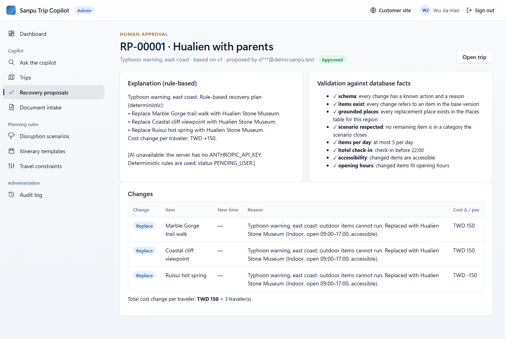

# Recovery proposal review

App B · Sanpu AI Travel

| | |
|---|---|
| **Route** | `/admin/proposals/1` |
| **Permission** | Ai.Proposal.Approve |
| **Shown as** | `supervisor@demo.sanpu.test` (fictional demo account) |
| **Area** | Admin |

## Purpose
Nothing changes until a human approves; the proposer cannot approve their own run

## Fields and validation
| Field | Type | Rules (client hint + server validation + SQL constraint) |
|---|---|---|
| Explanation | read only | AI text, marked "AI generated, check it" |
| Validation | read only | schema ✓ · items exist in DB ✓ · constraints ✓ |
| Reviewer comment | textarea | required on reject |

## Actions
- **Approve & apply (new version)**
- **Reject**
- **Request changes**

## API (Swagger: `/swagger`, tag in the OpenAPI document)
- `GET /api/v1/aiops/proposals/{id}`
- `POST /api/v1/aiops/proposals/{id}/decision {decision, comment, rowVersion}`

## Stored procedures
- `usp_Proposal_Decide (transaction: new itinerary version + audit)`

## Rules, audit and security effects
- Nothing changes until a human approves; the proposer cannot approve their own run

## States
Loading skeleton while data loads · empty state ("Nothing here yet.") · error box with the server's message, a **Retry** button and the **correlation ID** · 403 page when the role lacks the permission (the API refuses the same call).

## Automated tests
- `G01` simulate typhoon → proposal → proposer cannot approve → supervisor approves → traveler sees v2

## Presenter script (30 seconds)
Signed in as supervisor, open **Recovery proposal review**. Click **Approve & apply (new version)** and point out that everything on screen comes from SQL Server through `GET /api/v1/aiops/proposals/{id}`. Mention the permission (Ai.Proposal.Approve) is checked by the API, not only by hiding the menu, and that changes are written to the audit log.
