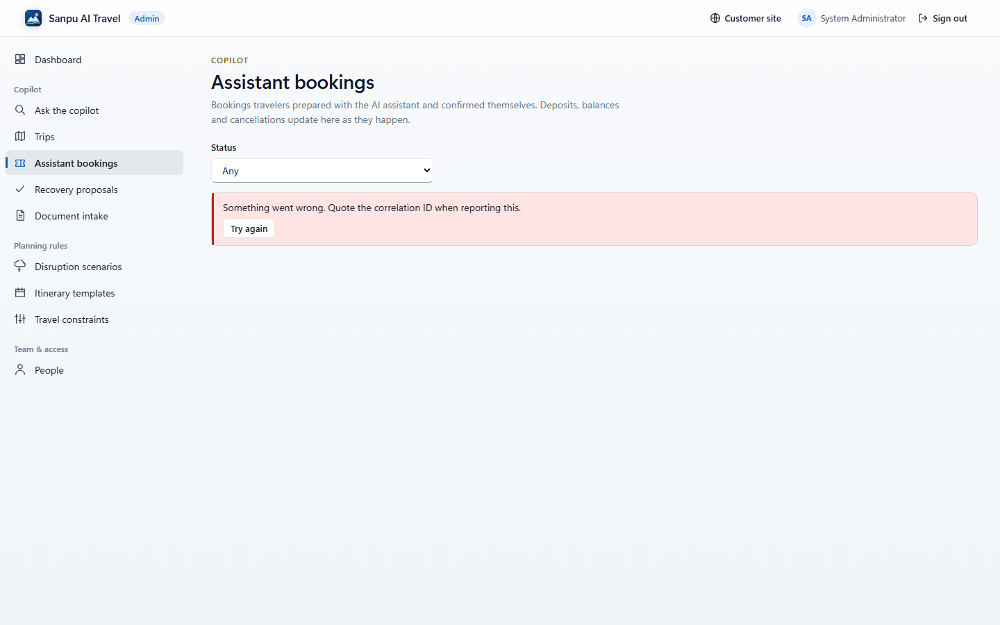

# Assistant bookings (admin)

App B · Sanpu AI Travel

| | |
|---|---|
| **Route** | `/admin/reservations` |
| **Permission** |  |
| **Shown as** | `admin@demo.sanpu.test` (fictional demo account) |
| **Area** | Admin |

## Purpose
Every booking travelers prepared with the assistant and confirmed themselves, with paid amounts and status.

## API (Swagger: `/swagger`, tag in the OpenAPI document)
- `GET /api/v1/aiops/reservations?status`

## Stored procedures
- `usp_Reservation_ListAll`

## States
Loading skeleton while data loads · empty state ("Nothing here yet.") · error box with the server's message, a **Retry** button and the **correlation ID** · 403 page when the role lacks the permission (the API refuses the same call).

## Automated tests
- Covered by the screenshot run (`tests/e2e/screens.spec.ts`) and manual checklist; no dedicated functional test yet.

## Presenter script (30 seconds)
Signed in as admin, open **Assistant bookings (admin)**. and point out that everything on screen comes from SQL Server through `GET /api/v1/aiops/reservations?status`. Mention the permission () is checked by the API, not only by hiding the menu, and that changes are written to the audit log.
