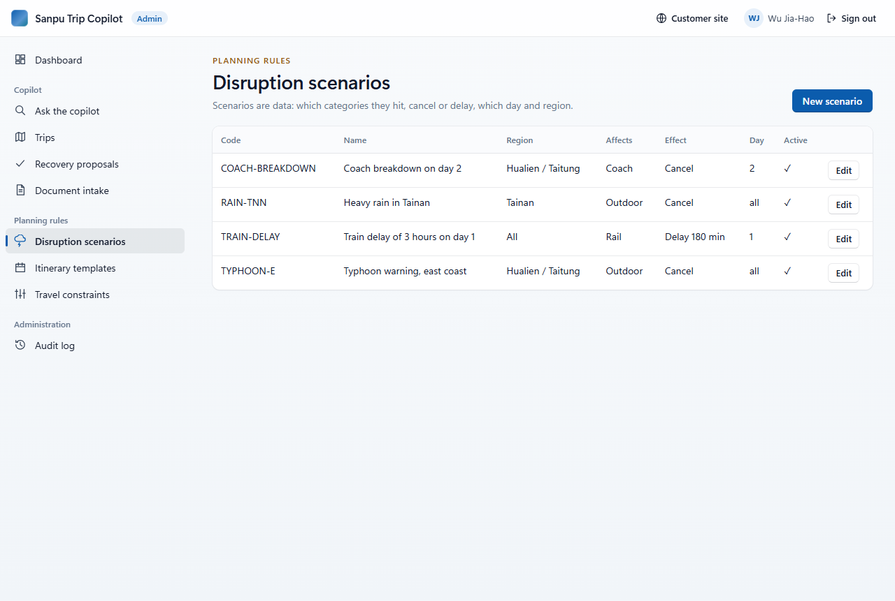

# Disruption scenarios

App B · AI Operations Copilot

| | |
|---|---|
| **Route** | `/admin/scenarios` |
| **Permission** | Scenario.Edit |
| **Shown as** | `supervisor@demo.sanpu.test` (fictional demo account) |
| **Area** | Admin |

## Purpose
SCENARIOS

## Fields and validation
| Field | Type | Rules (client hint + server validation + SQL constraint) |
|---|---|---|
| Scenario key | text | unique |
| Name | text | required |
| Affected categories | multi-select | Outdoor/Coach/Rail/Hotel/Meal |
| Effect | select | Cancel / Delay / Close |
| Delay minutes | number | 0–4320 |
| Region | select | from Regions |

## Actions
- **Save scenario**

## API (Swagger: `/swagger`, tag in the OpenAPI document)
- `GET/POST/PUT /api/v1/aiops/scenarios`

## Stored procedures
- `usp_Scenario_List`
- `usp_Scenario_Upsert`

## States
Loading skeleton while data loads · empty state ("Nothing here yet.") · error box with the server's message, a **Retry** button and the **correlation ID** · 403 page when the role lacks the permission (the API refuses the same call).

## Automated tests
- Covered by the screenshot run (`tests/e2e/screens.spec.ts`) and manual checklist; no dedicated functional test yet.

## Presenter script (30 seconds)
Signed in as supervisor, open **Disruption scenarios**. Click **Save scenario** and point out that everything on screen comes from SQL Server through `GET/POST/PUT /api/v1/aiops/scenarios`. Mention the permission (Scenario.Edit) is checked by the API, not only by hiding the menu, and that changes are written to the audit log.
