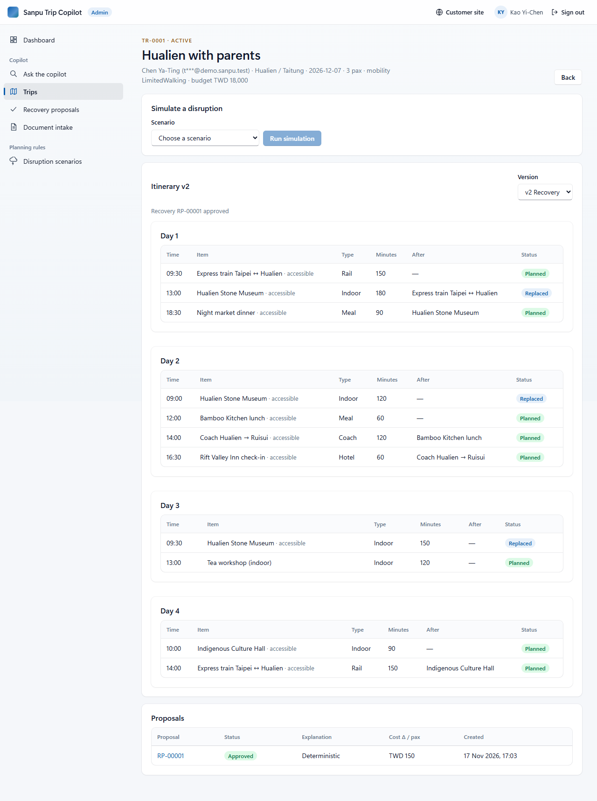

# Run disruption simulation

App B · AI Operations Copilot

| | |
|---|---|
| **Route** | `/admin/trips/1` |
| **Permission** | Simulation.Run |
| **Shown as** | `ops.agent@demo.sanpu.test` (fictional demo account) |
| **Area** | Admin |

## Purpose
Feasibility check is deterministic Domain code (dependency graph, opening hours, mobility); AI only writes the explanation and ranks options

## Fields and validation
| Field | Type | Rules (client hint + server validation + SQL constraint) |
|---|---|---|
| Trip | select | required |
| Scenario | select | required |
| Use AI for explanation | toggle | off = deterministic only |

## Actions
- **Run simulation**
- **Generate recovery proposal**

## API (Swagger: `/swagger`, tag in the OpenAPI document)
- `POST /api/v1/aiops/simulations {tripId, scenarioId}`
- `POST /api/v1/aiops/simulations/{id}/proposal`

## Stored procedures
- `usp_Sim_Inputs`
- `usp_Sim_Save`
- `usp_Sim_Get`
- `usp_Proposal_Save`

## Rules, audit and security effects
- Feasibility check is deterministic Domain code (dependency graph, opening hours, mobility); AI only writes the explanation and ranks options

## States
Loading skeleton while data loads · empty state ("Nothing here yet.") · error box with the server's message, a **Retry** button and the **correlation ID** · 403 page when the role lacks the permission (the API refuses the same call).

## Automated tests
- `G01` simulate typhoon → proposal → proposer cannot approve → supervisor approves → traveler sees v2

## Presenter script (30 seconds)
Signed in as ops.agent, open **Run disruption simulation**. Click **Run simulation** and point out that everything on screen comes from SQL Server through `POST /api/v1/aiops/simulations`. Mention the permission (Simulation.Run) is checked by the API, not only by hiding the menu, and that changes are written to the audit log.
