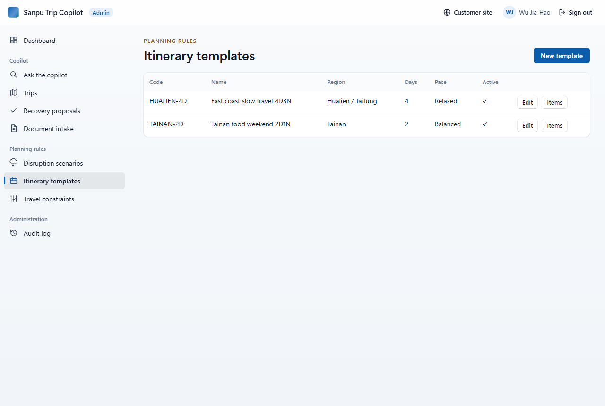

# Itinerary templates

App B · Sanpu AI Travel

| | |
|---|---|
| **Route** | `/admin/templates` |
| **Permission** | Template.Edit |
| **Shown as** | `supervisor@demo.sanpu.test` (fictional demo account) |
| **Area** | Admin |

## Purpose
Templates the trip generator starts from: region, days, pace and the ordered items with dependencies.

## API (Swagger: `/swagger`, tag in the OpenAPI document)
- `GET /api/v1/aiops/templates`
- `POST/PUT /api/v1/aiops/templates`

## Stored procedures
- `usp_Template_List`
- `usp_Template_Upsert`

## States
Loading skeleton while data loads · empty state ("Nothing here yet.") · error box with the server's message, a **Retry** button and the **correlation ID** · 403 page when the role lacks the permission (the API refuses the same call).

## Automated tests
- Covered by the screenshot run (`tests/e2e/screens.spec.ts`) and manual checklist; no dedicated functional test yet.

## Presenter script (30 seconds)
Signed in as supervisor, open **Itinerary templates**. and point out that everything on screen comes from SQL Server through `GET /api/v1/aiops/templates`. Mention the permission (Template.Edit) is checked by the API, not only by hiding the menu, and that changes are written to the audit log.
