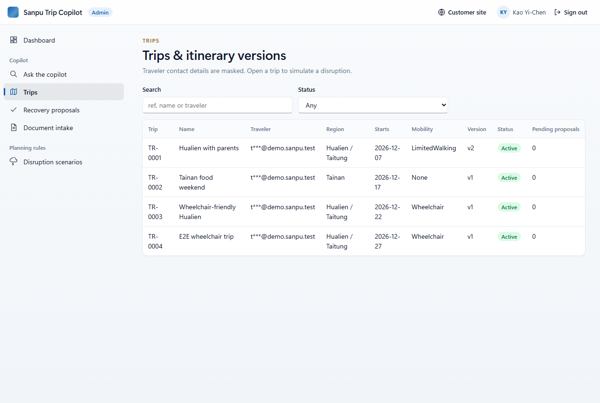

# Trips & itinerary versions

App B · Sanpu AI Travel

| | |
|---|---|
| **Route** | `/admin/trips` |
| **Permission** | Trip.View |
| **Shown as** | `ops.agent@demo.sanpu.test` (fictional demo account) |
| **Area** | Admin |

## Purpose
TRIPS

## Actions
- **Open**
- **Switch version**

## API (Swagger: `/swagger`, tag in the OpenAPI document)
- `GET /api/v1/aiops/trips`
- `GET /api/v1/aiops/trips/{id}?version=`

## Stored procedures
- `usp_Trip_List`
- `usp_Trip_Get`

## States
Loading skeleton while data loads · empty state ("Nothing here yet.") · error box with the server's message, a **Retry** button and the **correlation ID** · 403 page when the role lacks the permission (the API refuses the same call).

## Automated tests
- Covered by the screenshot run (`tests/e2e/screens.spec.ts`) and manual checklist; no dedicated functional test yet.

## Presenter script (30 seconds)
Signed in as ops.agent, open **Trips & itinerary versions**. Click **Open** and point out that everything on screen comes from SQL Server through `GET /api/v1/aiops/trips`. Mention the permission (Trip.View) is checked by the API, not only by hiding the menu, and that changes are written to the audit log.
