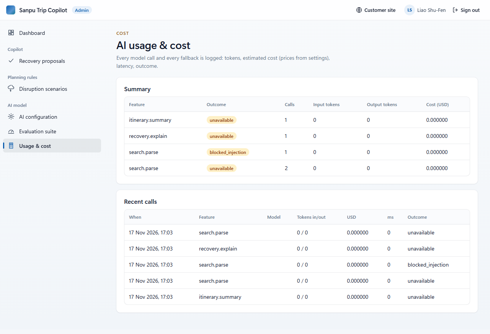

# AI usage & cost

App B · Sanpu AI Travel

| | |
|---|---|
| **Route** | `/admin/ai-usage` |
| **Permission** | Ai.Usage.View |
| **Shown as** | `ai.engineer@demo.sanpu.test` (fictional demo account) |
| **Area** | Admin |

## Purpose
COST

## API (Swagger: `/swagger`, tag in the OpenAPI document)
- `GET /api/v1/aiops/ai-usage?from=&to=`

## Stored procedures
- `usp_AiUsage_List`

## States
Loading skeleton while data loads · empty state ("Nothing here yet.") · error box with the server's message, a **Retry** button and the **correlation ID** · 403 page when the role lacks the permission (the API refuses the same call).

## Automated tests
- Covered by the screenshot run (`tests/e2e/screens.spec.ts`) and manual checklist; no dedicated functional test yet.

## Presenter script (30 seconds)
Signed in as ai.engineer, open **AI usage & cost**. and point out that everything on screen comes from SQL Server through `GET /api/v1/aiops/ai-usage?from=&to=`. Mention the permission (Ai.Usage.View) is checked by the API, not only by hiding the menu, and that changes are written to the audit log.
