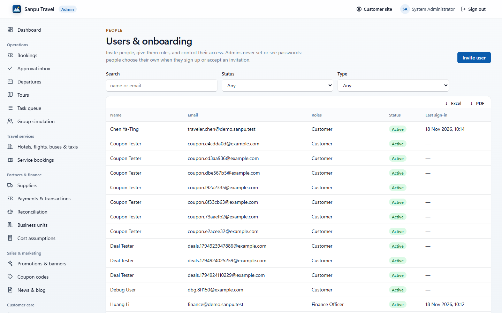

# People: access requests

App A · Sanpu Travel (the same screen exists in both apps)

| | |
|---|---|
| **Route** | `/admin/users` |
| **Permission** |  |
| **Shown as** | `admin@demo.sanpu.test` (fictional demo account) |
| **Area** | Admin |

## Purpose
Pending staff requests appear above the user list. Approve (optionally with a different role) or reject; the person gets an email either way and can sign in once approved.

## API (Swagger: `/swagger`, tag in the OpenAPI document)
- `GET /api/v1/admin/users/access-requests`
- `POST /api/v1/admin/users/access-requests/{id} {approve, roleKey}`

## Stored procedures
- `usp_Admin_ListAccessRequests`
- `usp_Admin_DecideAccessRequest`

## States
Loading skeleton while data loads · empty state ("Nothing here yet.") · error box with the server's message, a **Retry** button and the **correlation ID** · 403 page when the role lacks the permission (the API refuses the same call).

## Automated tests
- Covered by the screenshot run (`tests/e2e/screens.spec.ts`) and manual checklist; no dedicated functional test yet.

## Presenter script (30 seconds)
Signed in as admin, open **People: access requests**. and point out that everything on screen comes from SQL Server through `GET /api/v1/admin/users/access-requests`. Mention the permission () is checked by the API, not only by hiding the menu, and that changes are written to the audit log.
