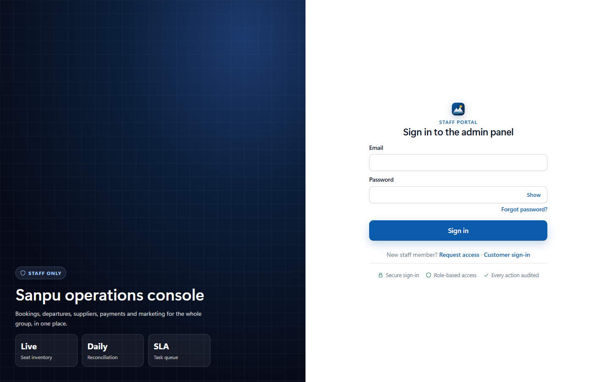

# Staff sign-in (admin panel)

App A · Sanpu Travel (the same screen exists in both apps)

| | |
|---|---|
| **Route** | `/admin/login` |
| **Permission** |  |
| **Shown as** | anonymous visitor |
| **Area** | Admin |

## Purpose
Staff sign in here, separately from the customer site. The admin panel has its own session (cookies and token), so a staff member and a customer can be signed in at the same time in one browser. Customers who try this page are refused with a pointer to the customer sign-in.

## API (Swagger: `/swagger`, tag in the OpenAPI document)
- `POST /api/v1/auth/login (header X-Session-Realm: admin) → 200 token; 403 wrong_portal for customer accounts; 403 pending_approval / request_rejected for staff requests`

## Stored procedures
- `usp_Auth_GetUserByEmail (returns ApprovalStatus)`
- `usp_Auth_RecordLoginResult`

## States
Loading skeleton while data loads · empty state ("Nothing here yet.") · error box with the server's message, a **Retry** button and the **correlation ID** · 403 page when the role lacks the permission (the API refuses the same call).

## Automated tests
- Covered by the screenshot run (`tests/e2e/screens.spec.ts`) and manual checklist; no dedicated functional test yet.

## Presenter script (30 seconds)
As an anonymous visitor, open **Staff sign-in (admin panel)**. and point out that everything on screen comes from SQL Server through `POST /api/v1/auth/login`. Mention the permission () is checked by the API, not only by hiding the menu, and that changes are written to the audit log.
