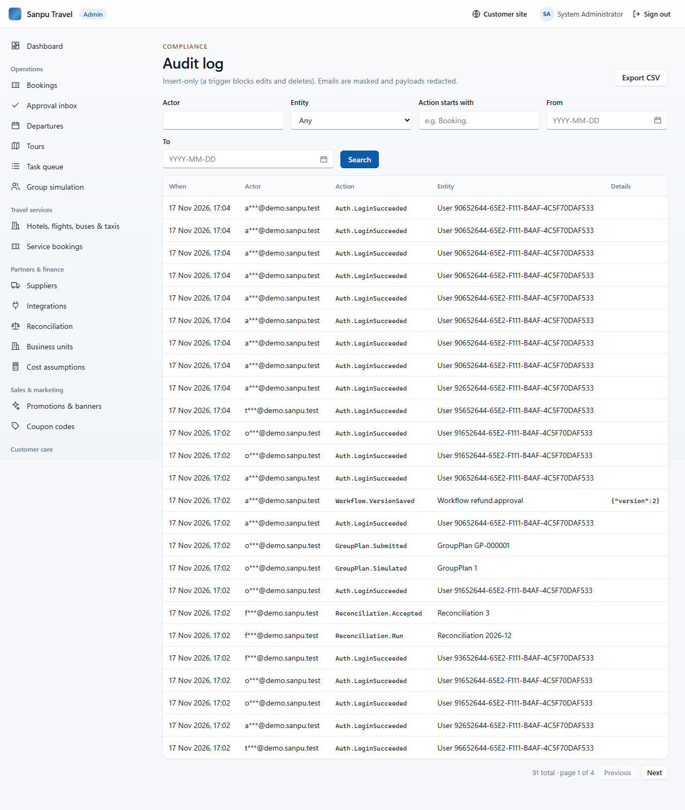

# Audit log

App A · Sanpu Travel (the same screen exists in both apps)

| | |
|---|---|
| **Route** | `/admin/audit` |
| **Permission** | Admin.Audit.View |
| **Shown as** | `admin@demo.sanpu.test` (fictional demo account) |
| **Area** | Admin |

## Purpose
PII is never written raw: emails are masked, payloads redacted

## Fields and validation
| Field | Type | Rules (client hint + server validation + SQL constraint) |
|---|---|---|
| Actor | text | email contains |
| Entity | select | User / Role / Menu / Setting / Booking / Proposal… |
| Action | text |  |
| From / To (UTC) | date range | From ≤ To · max 90 days |

## Actions
- **Search**
- **Export CSV**

## API (Swagger: `/swagger`, tag in the OpenAPI document)
- `GET /api/v1/admin/audit?actor=&entity=&action=&from=&to=&page=`

## Stored procedures
- `usp_Audit_Search`
- `usp_Audit_Write (insert-only; UPDATE/DELETE blocked by trigger)`

## Rules, audit and security effects
- PII is never written raw: emails are masked, payloads redacted

## States
Loading skeleton while data loads · empty state ("Nothing here yet.") · error box with the server's message, a **Retry** button and the **correlation ID** · 403 page when the role lacks the permission (the API refuses the same call).

## Automated tests
- `D06` audit log filters by entity

## Presenter script (30 seconds)
Signed in as admin, open **Audit log**. Click **Search** and point out that everything on screen comes from SQL Server through `GET /api/v1/admin/audit?actor=&entity=&action=&from=&to=&page=`. Mention the permission (Admin.Audit.View) is checked by the API, not only by hiding the menu, and that changes are written to the audit log.
