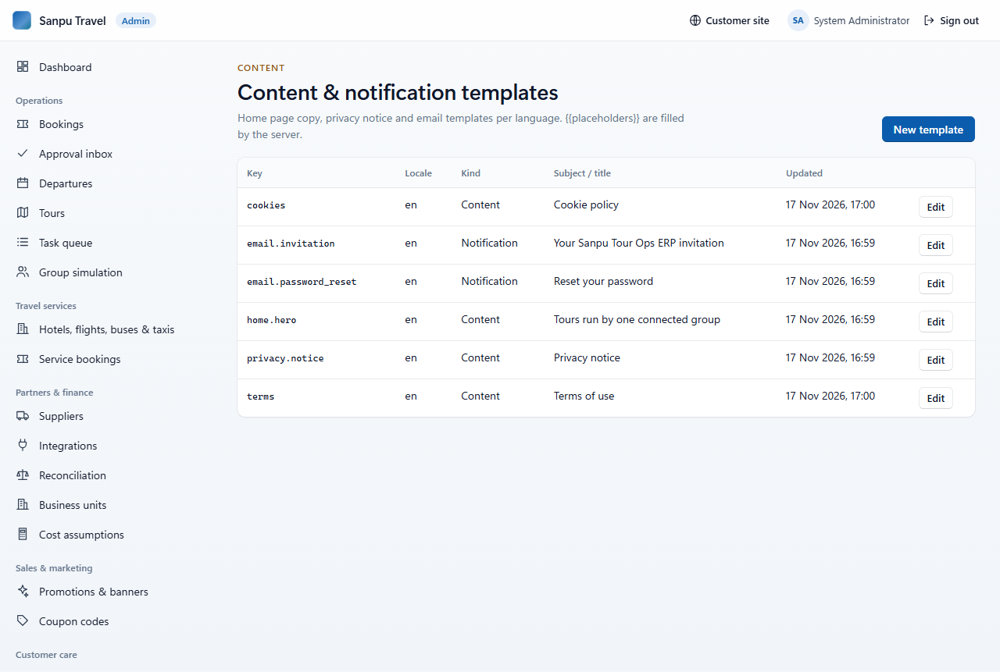

# Content & notification templates

App A · Sanpu Travel (the same screen exists in both apps)

| | |
|---|---|
| **Route** | `/admin/content` |
| **Permission** | Admin.Content.Edit |
| **Shown as** | `admin@demo.sanpu.test` (fictional demo account) |
| **Area** | Admin |

## Purpose
CONTENT

## Fields and validation
| Field | Type | Rules (client hint + server validation + SQL constraint) |
|---|---|---|
| Subject / Title | text | required · max 200 |
| Body | textarea | required · max 8000 · {{placeholders}} from a fixed list |

## Actions
- **Save**
- **Preview**

## API (Swagger: `/swagger`, tag in the OpenAPI document)
- `GET/PUT /api/v1/admin/content`

## Stored procedures
- `usp_Admin_Content_List`
- `usp_Admin_Content_Upsert`

## States
Loading skeleton while data loads · empty state ("Nothing here yet.") · error box with the server's message, a **Retry** button and the **correlation ID** · 403 page when the role lacks the permission (the API refuses the same call).

## Automated tests
- Covered by the screenshot run (`tests/e2e/screens.spec.ts`) and manual checklist; no dedicated functional test yet.

## Presenter script (30 seconds)
Signed in as admin, open **Content & notification templates**. Click **Save** and point out that everything on screen comes from SQL Server through `GET/PUT /api/v1/admin/content`. Mention the permission (Admin.Content.Edit) is checked by the API, not only by hiding the menu, and that changes are written to the audit log.
