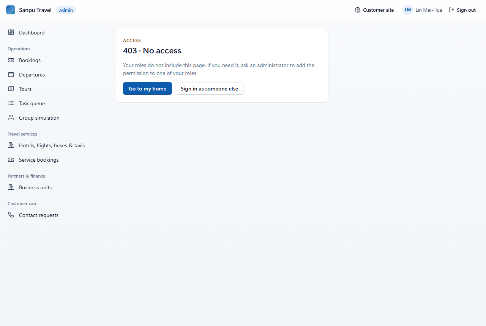

# 403 · No access

App A · Sanpu Travel (the same screen exists in both apps)

| | |
|---|---|
| **Route** | `/admin/users` |
| **Permission** | any |
| **Shown as** | `agent@demo.sanpu.test` (fictional demo account) |
| **Area** | Public |

## Purpose
Also: loading skeleton, empty state ("Nothing here yet") and error state with Retry and a correlation ID, used on every list

## Actions
- **Go to my home**
- **Sign in as someone else**

## API (Swagger: `/swagger`, tag in the OpenAPI document)
- `Shown when the API returns 403 or the route is not in /navigation/me`

## Stored procedures
- (read through shared navigation/settings procedures)

## Rules, audit and security effects
- Also: loading skeleton, empty state ("Nothing here yet") and error state with Retry and a correlation ID, used on every list

## States
Loading skeleton while data loads · empty state ("Nothing here yet.") · error box with the server's message, a **Retry** button and the **correlation ID** · 403 page when the role lacks the permission (the API refuses the same call).

## Automated tests
- `B01` invite → accept → login → permitted menu; role change revokes access on the next request
- `H03` AI settings: status shows the key is missing; typed validation on edits

## Presenter script (30 seconds)
Signed in as agent, open **403 · No access**. Click **Go to my home** and point out that everything on screen comes from SQL Server through `Shown when`. Mention the permission (any) is checked by the API, not only by hiding the menu, and that changes are written to the audit log.
