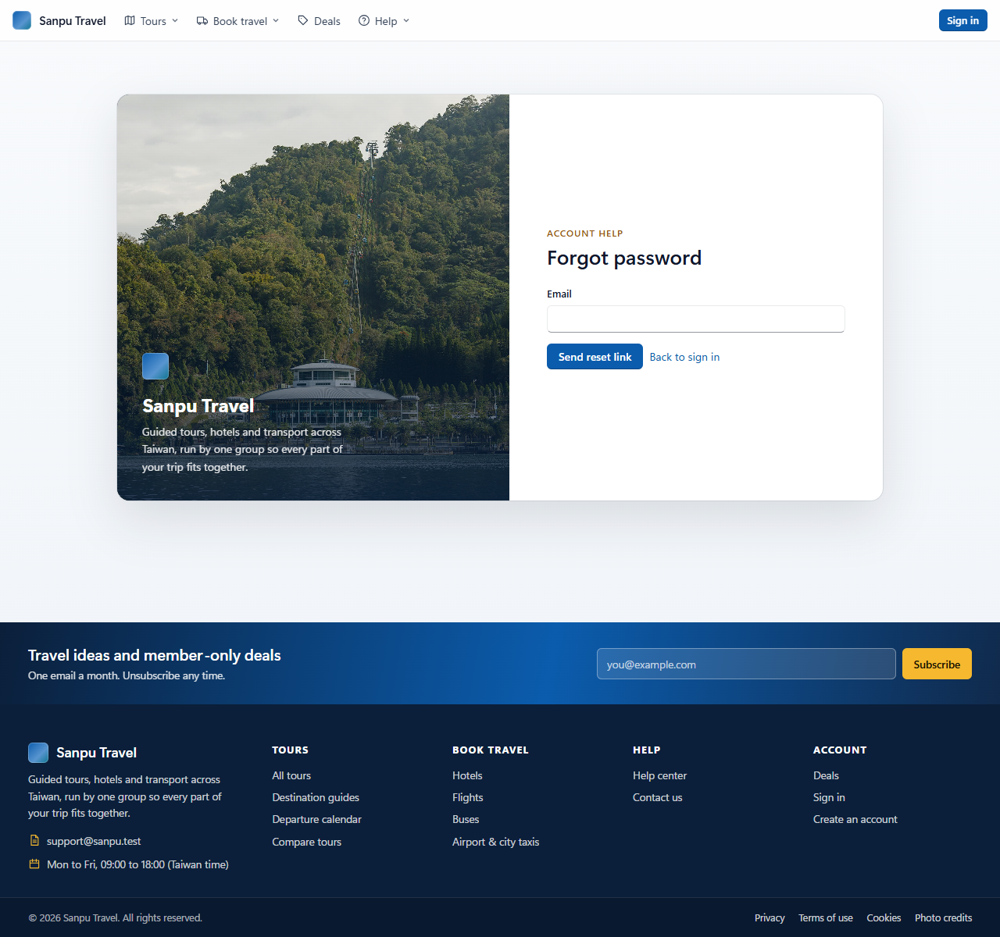

# Forgot password

App A · Tour Operations ERP (the same screen exists in both apps)

| | |
|---|---|
| **Route** | `/forgot-password` |
| **Permission** | anonymous |
| **Shown as** | anonymous visitor |
| **Area** | Public |

## Purpose
Token: 32 random bytes, only the SHA-256 hash is stored, expires in 30 min

## Fields and validation
| Field | Type | Rules (client hint + server validation + SQL constraint) |
|---|---|---|
| Email | email | required · valid email |

## Actions
- **Send reset link**
- **Back to sign in**

## API (Swagger: `/swagger`, tag in the OpenAPI document)
- `POST /api/v1/auth/forgot-password → 202 always (no enumeration)`

## Stored procedures
- `usp_Auth_CreatePasswordReset`

## Rules, audit and security effects
- Token: 32 random bytes, only the SHA-256 hash is stored, expires in 30 min
- Email goes to the local test inbox (Mailpit / dev outbox table) while SMTP is not set up

## States
Loading skeleton while data loads · empty state ("Nothing here yet.") · error box with the server's message, a **Retry** button and the **correlation ID** · 403 page when the role lacks the permission (the API refuses the same call).

## Automated tests
- `A04` password reset through the local test inbox

## Presenter script (30 seconds)
As an anonymous visitor, open **Forgot password**. Click **Send reset link** and point out that everything on screen comes from SQL Server through `POST /api/v1/auth/forgot-password`. Mention the permission (anonymous) is checked by the API, not only by hiding the menu, and that changes are written to the audit log.
