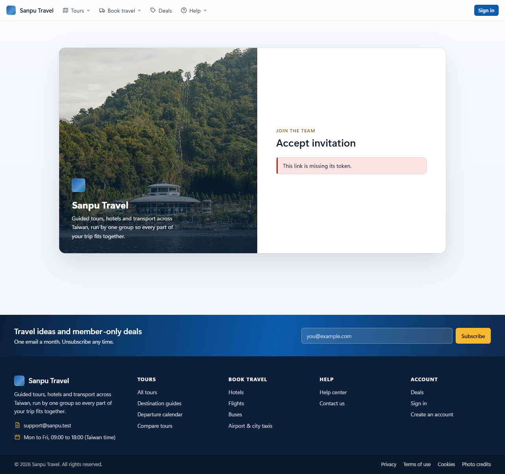

# Accept invitation

App A · Sanpu Travel (the same screen exists in both apps)

| | |
|---|---|
| **Route** | `/accept-invitation` |
| **Permission** | one-time token |
| **Shown as** | anonymous visitor |
| **Area** | Public |

## Purpose
Invites expire after 72 h (AppSettings Auth.InvitationHours)

## Fields and validation
| Field | Type | Rules (client hint + server validation + SQL constraint) |
|---|---|---|
| Display name | text | required · 2–100 |
| Password | password | password policy |
| Confirm password | password | must match |

## Actions
- **Activate account**

## API (Swagger: `/swagger`, tag in the OpenAPI document)
- `GET /api/v1/auth/invitation?token= → 200 {email, displayName}`
- `POST /api/v1/auth/accept-invitation → 204`

## Stored procedures
- `usp_Auth_GetInvitation`
- `usp_Auth_AcceptInvitation (transaction: set hash, EmailVerifiedAtUtc, AcceptedAtUtc)`

## Rules, audit and security effects
- Invites expire after 72 h (AppSettings Auth.InvitationHours)
- The admin never sees or sets the password

## States
Loading skeleton while data loads · empty state ("Nothing here yet.") · error box with the server's message, a **Retry** button and the **correlation ID** · 403 page when the role lacks the permission (the API refuses the same call).

## Automated tests
- `B01` invite → accept → login → permitted menu; role change revokes access on the next request

## Presenter script (30 seconds)
As an anonymous visitor, open **Accept invitation**. Click **Activate account** and point out that everything on screen comes from SQL Server through `GET /api/v1/auth/invitation?token=`. Mention the permission (one-time token) is checked by the API, not only by hiding the menu, and that changes are written to the audit log.
