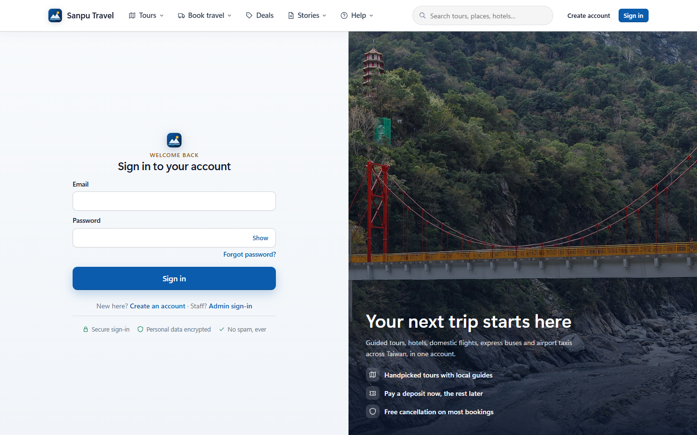

# Sign in

App A · Sanpu Travel (the same screen exists in both apps)

| | |
|---|---|
| **Route** | `/login` |
| **Permission** | anonymous |
| **Shown as** | anonymous visitor |
| **Area** | Public |

## Purpose
Access token is kept in memory only, never in localStorage

## Fields and validation
| Field | Type | Rules (client hint + server validation + SQL constraint) |
|---|---|---|
| Email | email | required · trimmed + lower-cased · max 256 |
| Password | password | required · 12–128 chars |
| Remember this device | checkbox | sets the refresh cookie for 14 days instead of a session |

## Actions
- **Sign in**
- **Forgot password?**

## API (Swagger: `/swagger`, tag in the OpenAPI document)
- `POST /api/v1/auth/login → 200 {accessToken, expiresIn} + HttpOnly refresh cookie`
- `401 invalid_credentials (same text for unknown email: no user enumeration)`
- `423 account_locked after 5 failed tries (lockout 15 min, from AppSettings)`
- `429 rate limited (10 per min per IP)`

## Stored procedures
- `usp_Auth_GetUserByEmail`
- `usp_Auth_RecordLoginResult`
- `usp_Auth_RotateRefreshToken`

## Rules, audit and security effects
- Access token is kept in memory only, never in localStorage
- Audit: Auth.LoginSucceeded / Auth.LoginFailed (email masked)

## States
Loading skeleton while data loads · empty state ("Nothing here yet.") · error box with the server's message, a **Retry** button and the **correlation ID** · 403 page when the role lacks the permission (the API refuses the same call).

## Automated tests
- `A01` sign-in success, wrong password and field validation
- `A02` session survives reload (refresh cookie), logout ends it, anonymous admin redirects

## Presenter script (30 seconds)
As an anonymous visitor, open **Sign in**. Click **Sign in** and point out that everything on screen comes from SQL Server through `POST /api/v1/auth/login`. Mention the permission (anonymous) is checked by the API, not only by hiding the menu, and that changes are written to the audit log.
