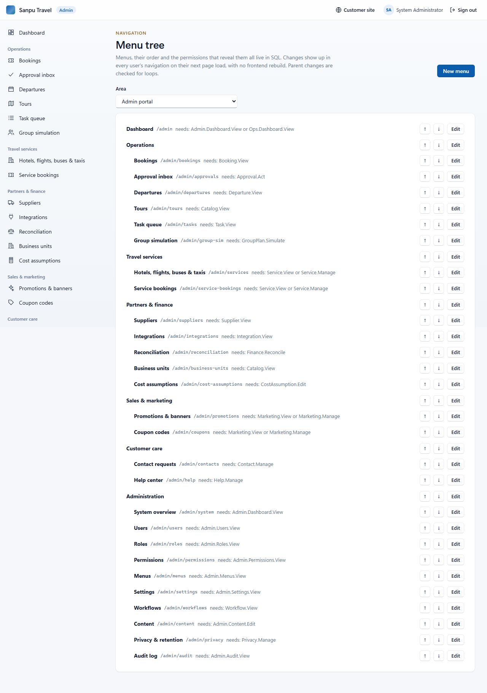

# Menu tree

App A · Tour Operations ERP (the same screen exists in both apps)

| | |
|---|---|
| **Route** | `/admin/menus` |
| **Permission** | Admin.Menus.Edit |
| **Shown as** | `admin@demo.sanpu.test` (fictional demo account) |
| **Area** | Admin |

## Purpose
NAVIGATION

## Fields and validation
| Field | Type | Rules (client hint + server validation + SQL constraint) |
|---|---|---|
| Menu key | text | required · unique · ^[a-z0-9.-]+$ · locked after create |
| Title | text | required · max 100 |
| Parent | select | must not be itself or a descendant (cycle check in proc) |
| Route | text | starts with / · unique per area |
| Icon | select | icon key list |
| Area | radio | Admin / Customer |
| Sort order | number | 0–9999 |
| Visible / Active | toggle |  |
| Required permissions | multi-select | ANY of these shows the menu |

## Actions
- **Save menu**
- **Move up**
- **Move down**
- **Delete**

## API (Swagger: `/swagger`, tag in the OpenAPI document)
- `GET /api/v1/admin/menus?area=`
- `POST/PUT /api/v1/admin/menus`
- `PUT /api/v1/admin/menus/{id}/permissions`
- `POST /api/v1/admin/menus/{id}/move`
- `DELETE /api/v1/admin/menus/{id} (409 has_children)`
- `GET /api/v1/admin/menus/preview?roleId=`

## Stored procedures
- `usp_Admin_Menus_GetTree`
- `usp_Admin_Menus_Upsert (recursive CTE cycle check → error 50010)`
- `usp_Admin_Menus_SetPermissions`
- `usp_Admin_Menus_Move`
- `usp_Admin_Menus_Delete`

## States
Loading skeleton while data loads · empty state ("Nothing here yet.") · error box with the server's message, a **Retry** button and the **correlation ID** · 403 page when the role lacks the permission (the API refuses the same call).

## Automated tests
- `B02` menu tree: reorder shows up for users without a rebuild; cycles are refused

## Presenter script (30 seconds)
Signed in as admin, open **Menu tree**. Click **Save menu** and point out that everything on screen comes from SQL Server through `GET /api/v1/admin/menus?area=`. Mention the permission (Admin.Menus.Edit) is checked by the API, not only by hiding the menu, and that changes are written to the audit log.
