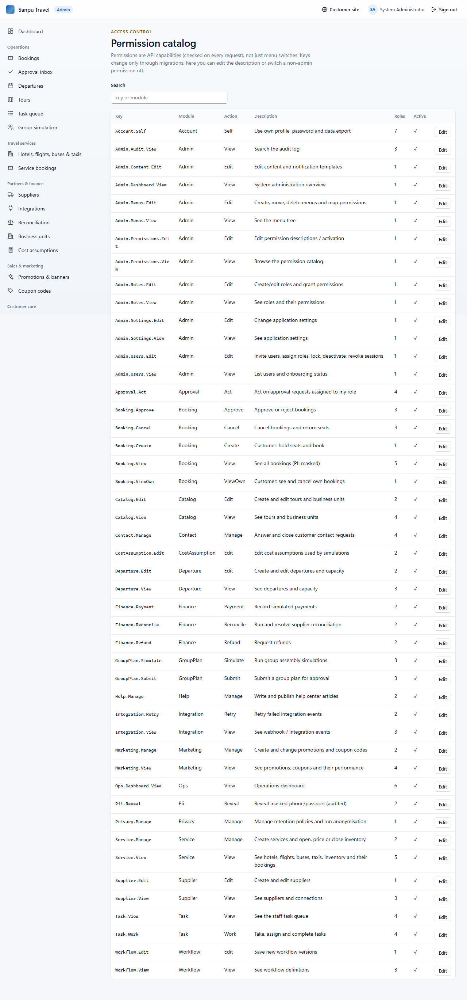

# Permission catalog

App A · Tour Operations ERP (the same screen exists in both apps)

| | |
|---|---|
| **Route** | `/admin/permissions` |
| **Permission** | Admin.Permissions.View |
| **Shown as** | `admin@demo.sanpu.test` (fictional demo account) |
| **Area** | Admin |

## Purpose
ACCESS CONTROL

## Fields and validation
| Field | Type | Rules (client hint + server validation + SQL constraint) |
|---|---|---|
| Search | text | key / module |
| Description (edit) | text | max 500 |

## Actions
- **Save description**

## API (Swagger: `/swagger`, tag in the OpenAPI document)
- `GET /api/v1/admin/permissions?search=`
- `PUT /api/v1/admin/permissions/{id} (description and active flag only; keys change only by migration)`

## Stored procedures
- `usp_Admin_Permissions_List`
- `usp_Admin_Permissions_Update`

## States
Loading skeleton while data loads · empty state ("Nothing here yet.") · error box with the server's message, a **Retry** button and the **correlation ID** · 403 page when the role lacks the permission (the API refuses the same call).

## Automated tests
- Covered by the screenshot run (`tests/e2e/screens.spec.ts`) and manual checklist; no dedicated functional test yet.

## Presenter script (30 seconds)
Signed in as admin, open **Permission catalog**. Click **Save description** and point out that everything on screen comes from SQL Server through `GET /api/v1/admin/permissions?search=`. Mention the permission (Admin.Permissions.View) is checked by the API, not only by hiding the menu, and that changes are written to the audit log.
