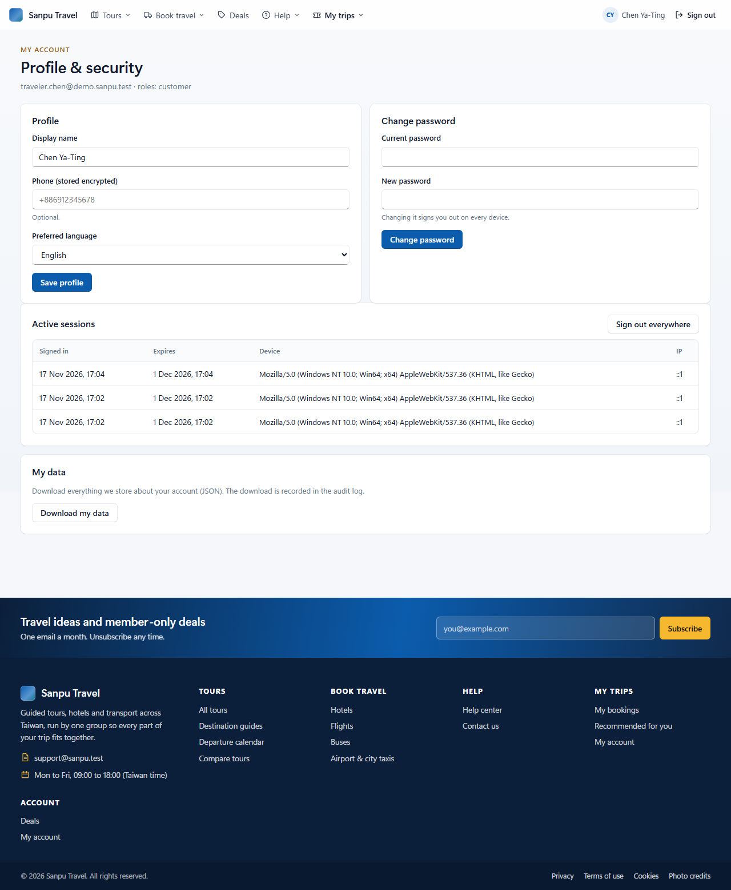

# My profile

App A · Sanpu Travel (the same screen exists in both apps)

| | |
|---|---|
| **Route** | `/account` |
| **Permission** | signed in |
| **Shown as** | `traveler.chen@demo.sanpu.test` (fictional demo account) |
| **Area** | Customer |

## Purpose
MY ACCOUNT

## Fields and validation
| Field | Type | Rules (client hint + server validation + SQL constraint) |
|---|---|---|
| Display name | text | required · 2–100 |
| Email | email | read only |
| Phone | tel | optional · E.164 · encrypted at rest · shown masked |
| Preferred language | select | English only |
| Current password | password | required to change password |
| New password | password | password policy |

## Actions
- **Save profile**
- **Change password**
- **Sign out of all devices**
- **Download my data**

## API (Swagger: `/swagger`, tag in the OpenAPI document)
- `GET /api/v1/auth/me`
- `PUT /api/v1/account/profile`
- `POST /api/v1/account/change-password`
- `POST /api/v1/auth/logout-all`
- `GET /api/v1/account/export (personal-data export, audited)`

## Stored procedures
- `usp_Account_UpdateProfile`
- `usp_Auth_ChangePassword`
- `usp_Auth_RevokeSessions`

## States
Loading skeleton while data loads · empty state ("Nothing here yet.") · error box with the server's message, a **Retry** button and the **correlation ID** · 403 page when the role lacks the permission (the API refuses the same call).

## Automated tests
- Covered by the screenshot run (`tests/e2e/screens.spec.ts`) and manual checklist; no dedicated functional test yet.

## Presenter script (30 seconds)
Signed in as traveler.chen, open **My profile**. Click **Save profile** and point out that everything on screen comes from SQL Server through `GET /api/v1/auth/me`. Mention the permission (signed in) is checked by the API, not only by hiding the menu, and that changes are written to the audit log.
