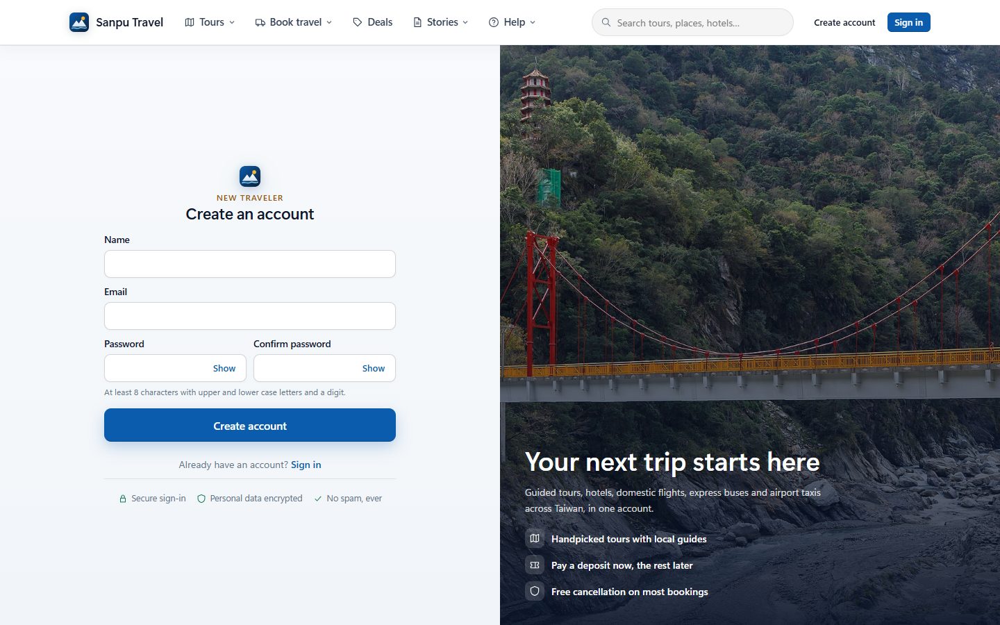

# Create an account

App A · Sanpu Travel (the same screen exists in both apps)

| | |
|---|---|
| **Route** | `/register` |
| **Permission** | anonymous |
| **Shown as** | anonymous visitor |
| **Area** | Customer |

## Purpose
Customer self sign-up (only when Feature.CustomerSignup is true). Creates a Customer user with the role named in Auth.DefaultCustomerRole.

## API (Swagger: `/swagger`, tag in the OpenAPI document)
- `POST /api/v1/auth/register`

## Stored procedures
- `usp_Auth_RegisterCustomer`

## States
Loading skeleton while data loads · empty state ("Nothing here yet.") · error box with the server's message, a **Retry** button and the **correlation ID** · 403 page when the role lacks the permission (the API refuses the same call).

## Automated tests
- Covered by the screenshot run (`tests/e2e/screens.spec.ts`) and manual checklist; no dedicated functional test yet.

## Presenter script (30 seconds)
As an anonymous visitor, open **Create an account**. and point out that everything on screen comes from SQL Server through `POST /api/v1/auth/register`. Mention the permission (anonymous) is checked by the API, not only by hiding the menu, and that changes are written to the audit log.
