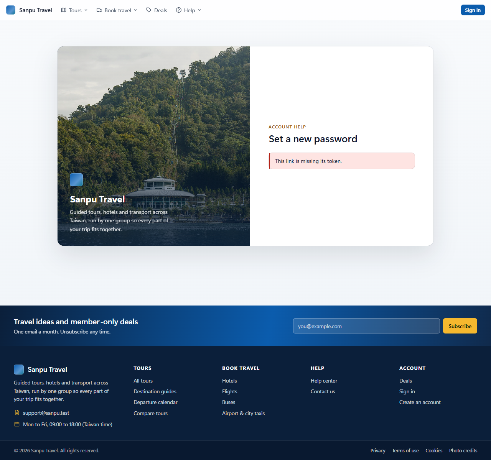

# Reset password

App A · Tour Operations ERP (the same screen exists in both apps)

| | |
|---|---|
| **Route** | `/reset-password` |
| **Permission** | one-time token |
| **Shown as** | anonymous visitor |
| **Area** | Public |

## Purpose
ACCOUNT HELP

## Fields and validation
| Field | Type | Rules (client hint + server validation + SQL constraint) |
|---|---|---|
| New password | password | 12–128 chars · upper, lower, digit · not the email |
| Confirm password | password | must match |

## Actions
- **Set new password**

## API (Swagger: `/swagger`, tag in the OpenAPI document)
- `POST /api/v1/auth/reset-password → 204`
- `400 token_invalid_or_expired`
- `422 password_policy`

## Stored procedures
- `usp_Auth_ConsumePasswordReset (also revokes every session and bumps SecurityStamp)`

## States
Loading skeleton while data loads · empty state ("Nothing here yet.") · error box with the server's message, a **Retry** button and the **correlation ID** · 403 page when the role lacks the permission (the API refuses the same call).

## Automated tests
- `A04` password reset through the local test inbox

## Presenter script (30 seconds)
As an anonymous visitor, open **Reset password**. Click **Set new password** and point out that everything on screen comes from SQL Server through `POST /api/v1/auth/reset-password`. Mention the permission (one-time token) is checked by the API, not only by hiding the menu, and that changes are written to the audit log.
