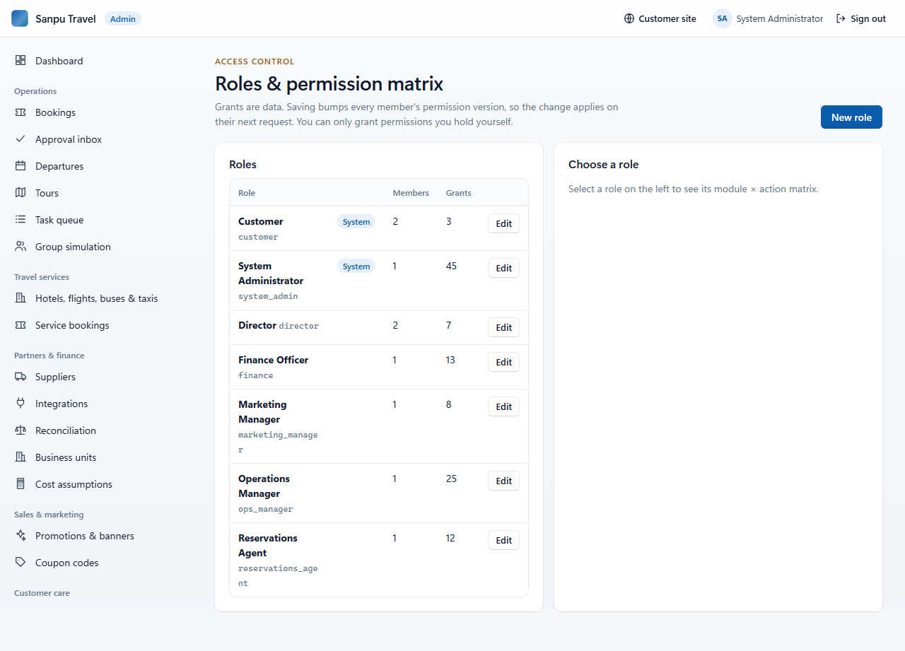

# Roles & permission matrix

App A · Sanpu Travel (the same screen exists in both apps)

| | |
|---|---|
| **Route** | `/admin/roles` |
| **Permission** | Admin.Roles.Edit |
| **Shown as** | `admin@demo.sanpu.test` (fictional demo account) |
| **Area** | Admin |

## Purpose
Anti-escalation: you can only grant permissions you hold yourself

## Fields and validation
| Field | Type | Rules (client hint + server validation + SQL constraint) |
|---|---|---|
| Role key | text | required · unique · ^[a-z0-9_]+$ · locked for system roles |
| Role name | text | required · max 100 |
| Description | textarea | max 500 |
| Active | toggle | system roles cannot be turned off |

## Actions
- **Save role**
- **Save permissions**
- **Preview effective menu**
- **Delete role**

## API (Swagger: `/swagger`, tag in the OpenAPI document)
- `GET /api/v1/admin/roles`
- `POST/PUT /api/v1/admin/roles`
- `PUT /api/v1/admin/roles/{id}/permissions`

## Stored procedures
- `usp_Admin_Roles_List`
- `usp_Admin_Roles_Upsert`
- `usp_Admin_Roles_SetPermissions (bumps PermissionVersion of every member)`

## Rules, audit and security effects
- Anti-escalation: you can only grant permissions you hold yourself
- Removing Admin.* from the last active system admin is blocked (error 50020)

## States
Loading skeleton while data loads · empty state ("Nothing here yet.") · error box with the server's message, a **Retry** button and the **correlation ID** · 403 page when the role lacks the permission (the API refuses the same call).

## Automated tests
- `B04` roles matrix: an admin role cannot lose admin rights (last admin protection)
- `C03` no IDOR, no privilege escalation, no forged tokens

## Presenter script (30 seconds)
Signed in as admin, open **Roles & permission matrix**. Click **Save role** and point out that everything on screen comes from SQL Server through `GET /api/v1/admin/roles`. Mention the permission (Admin.Roles.Edit) is checked by the API, not only by hiding the menu, and that changes are written to the audit log.
