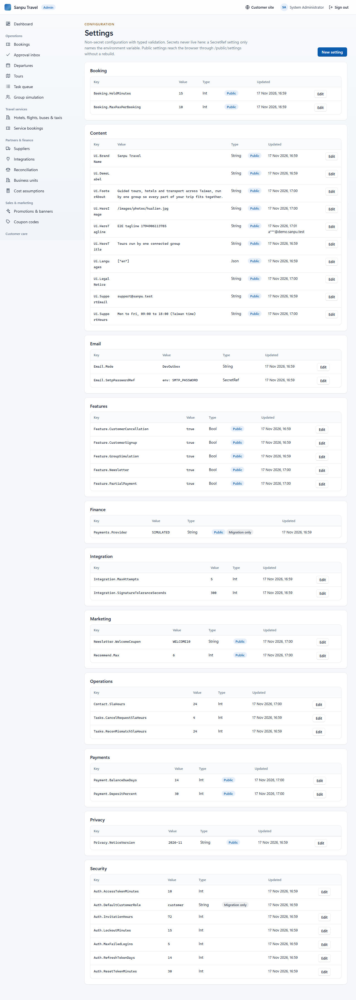

# Settings

App A · Tour Operations ERP (the same screen exists in both apps)

| | |
|---|---|
| **Route** | `/admin/settings` |
| **Permission** | Admin.Settings.View / Admin.Settings.Edit |
| **Shown as** | `admin@demo.sanpu.test` (fictional demo account) |
| **Area** | Admin |

## Purpose
Secrets are never stored here; the type "SecretRef" holds only the name of an env var

## Fields and validation
| Field | Type | Rules (client hint + server validation + SQL constraint) |
|---|---|---|
| Value (edit drawer) | typed input | Int → integer in Min/Max from schema · Bool → toggle · Json → JSON schema check · String → max length |
| Description | text | max 500 |

## Actions
- **Save**
- **Cancel**
- **New setting**

## API (Swagger: `/swagger`, tag in the OpenAPI document)
- `GET /api/v1/admin/settings?category=`
- `PUT /api/v1/admin/settings/{key} (rowVersion in the body → 409 when stale)`
- `GET /api/v1/public/settings (IsPublic only, no sign-in)`

## Stored procedures
- `usp_Admin_Settings_Get`
- `usp_Admin_Settings_Upsert`

## Rules, audit and security effects
- Secrets are never stored here; the type "SecretRef" holds only the name of an env var
- Cache is cleared on save, so the next request gets the new value without a frontend rebuild

## States
Loading skeleton while data loads · empty state ("Nothing here yet.") · error box with the server's message, a **Retry** button and the **correlation ID** · 403 page when the role lacks the permission (the API refuses the same call).

## Automated tests
- `B03` settings change reaches the public site without a rebuild
- `H03` AI settings: status shows the key is missing; typed validation on edits

## Presenter script (30 seconds)
Signed in as admin, open **Settings**. Click **Save** and point out that everything on screen comes from SQL Server through `GET /api/v1/admin/settings?category=`. Mention the permission (Admin.Settings.View / Admin.Settings.Edit) is checked by the API, not only by hiding the menu, and that changes are written to the audit log.
