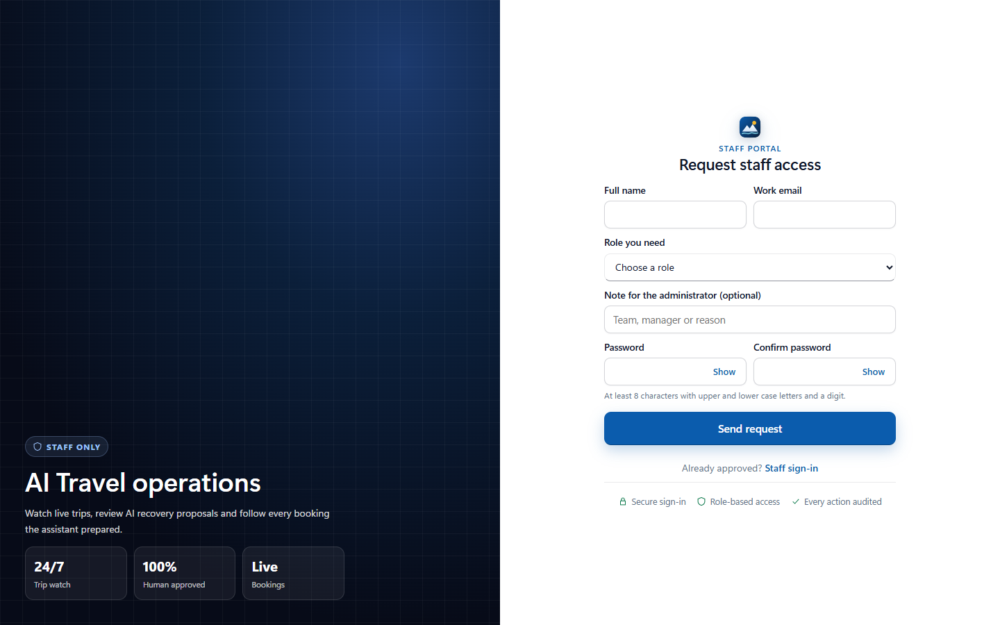

# Request staff access

App B · Sanpu AI Travel (the same screen exists in both apps)

| | |
|---|---|
| **Route** | `/admin/register` |
| **Permission** |  |
| **Shown as** | anonymous visitor |
| **Area** | Admin |

## Purpose
A new staff member enters name, work email, the role they need, an optional note and their own password. The account waits as Pending until an administrator approves it on People; an email confirms the request and the decision.

## API (Swagger: `/swagger`, tag in the OpenAPI document)
- `GET /api/v1/auth/staff-roles`
- `POST /api/v1/auth/staff-request → 202`

## Stored procedures
- `usp_Auth_StaffRoles`
- `usp_Auth_RequestStaffAccess`

## States
Loading skeleton while data loads · empty state ("Nothing here yet.") · error box with the server's message, a **Retry** button and the **correlation ID** · 403 page when the role lacks the permission (the API refuses the same call).

## Automated tests
- Covered by the screenshot run (`tests/e2e/screens.spec.ts`) and manual checklist; no dedicated functional test yet.

## Presenter script (30 seconds)
As an anonymous visitor, open **Request staff access**. and point out that everything on screen comes from SQL Server through `GET /api/v1/auth/staff-roles`. Mention the permission () is checked by the API, not only by hiding the menu, and that changes are written to the audit log.
