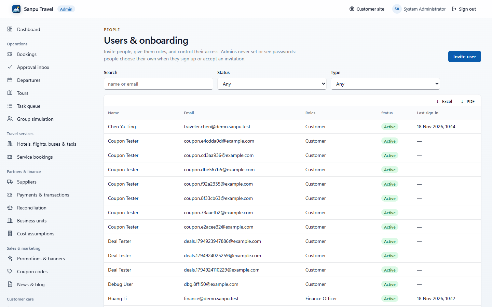

# Users & onboarding

App A · Sanpu Travel (the same screen exists in both apps)

| | |
|---|---|
| **Route** | `/admin/users` |
| **Permission** | Admin.Users.View / Admin.Users.Edit |
| **Shown as** | `admin@demo.sanpu.test` (fictional demo account) |
| **Area** | Admin |

## Purpose
You cannot deactivate yourself or the last active system admin

## Fields and validation
| Field | Type | Rules (client hint + server validation + SQL constraint) |
|---|---|---|
| Email (invite modal) | email | required · unique (409 duplicate_email) |
| Display name | text | required · 2–100 |
| Roles | multi-select | at least 1 · only roles you may grant |
| Send invitation email | checkbox | link also shown once for copying when SMTP is off |

## Actions
- **Invite user**
- **Activate / Deactivate**
- **Lock / Unlock**
- **Force password reset**
- **Revoke sessions**
- **Resend invite**

## API (Swagger: `/swagger`, tag in the OpenAPI document)
- `GET /api/v1/admin/users?search=&status=&page=`
- `POST /api/v1/admin/users/invite`
- `PUT /api/v1/admin/users/{id}/roles`
- `PUT /api/v1/admin/users/{id}/status`
- `POST /api/v1/admin/users/{id}/revoke-sessions`
- `POST /api/v1/admin/users/{id}/force-reset`

## Stored procedures
- `usp_Admin_Users_List`
- `usp_Admin_Users_Create (+ invitation, one transaction)`
- `usp_Admin_Users_AssignRoles`
- `usp_Admin_Users_UpdateStatus`
- `usp_Auth_RevokeSessions`

## Rules, audit and security effects
- You cannot deactivate yourself or the last active system admin

## States
Loading skeleton while data loads · empty state ("Nothing here yet.") · error box with the server's message, a **Retry** button and the **correlation ID** · 403 page when the role lacks the permission (the API refuses the same call).

## Automated tests
- `B01` invite → accept → login → permitted menu; role change revokes access on the next request

## Presenter script (30 seconds)
Signed in as admin, open **Users & onboarding**. Click **Invite user** and point out that everything on screen comes from SQL Server through `GET /api/v1/admin/users?search=&status=&page=`. Mention the permission (Admin.Users.View / Admin.Users.Edit) is checked by the API, not only by hiding the menu, and that changes are written to the audit log.
