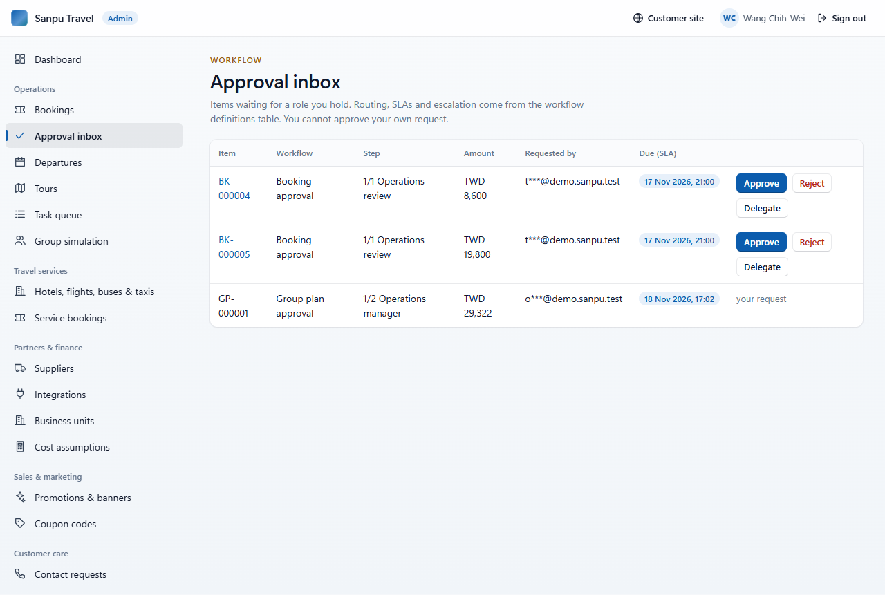

# Approval inbox

App A · Tour Operations ERP

| | |
|---|---|
| **Route** | `/admin/approvals` |
| **Permission** | Approval.Act |
| **Shown as** | `ops.manager@demo.sanpu.test` (fictional demo account) |
| **Area** | Admin |

## Purpose
WORKFLOW

## Fields and validation
| Field | Type | Rules (client hint + server validation + SQL constraint) |
|---|---|---|
| Delegate to | select | an active user holding the same role |
| Comment | textarea | required on reject |

## Actions
- **Approve**
- **Reject**
- **Delegate**

## API (Swagger: `/swagger`, tag in the OpenAPI document)
- `GET /api/v1/ops/approvals/inbox`
- `POST /api/v1/ops/approvals/{id}/act`

## Stored procedures
- `usp_Approval_Inbox`
- `usp_Approval_Act`

## States
Loading skeleton while data loads · empty state ("Nothing here yet.") · error box with the server's message, a **Retry** button and the **correlation ID** · 403 page when the role lacks the permission (the API refuses the same call).

## Automated tests
- `D04` group simulation saves a draft plan and needs another approver

## Presenter script (30 seconds)
Signed in as ops.manager, open **Approval inbox**. Click **Approve** and point out that everything on screen comes from SQL Server through `GET /api/v1/ops/approvals/inbox`. Mention the permission (Approval.Act) is checked by the API, not only by hiding the menu, and that changes are written to the audit log.
