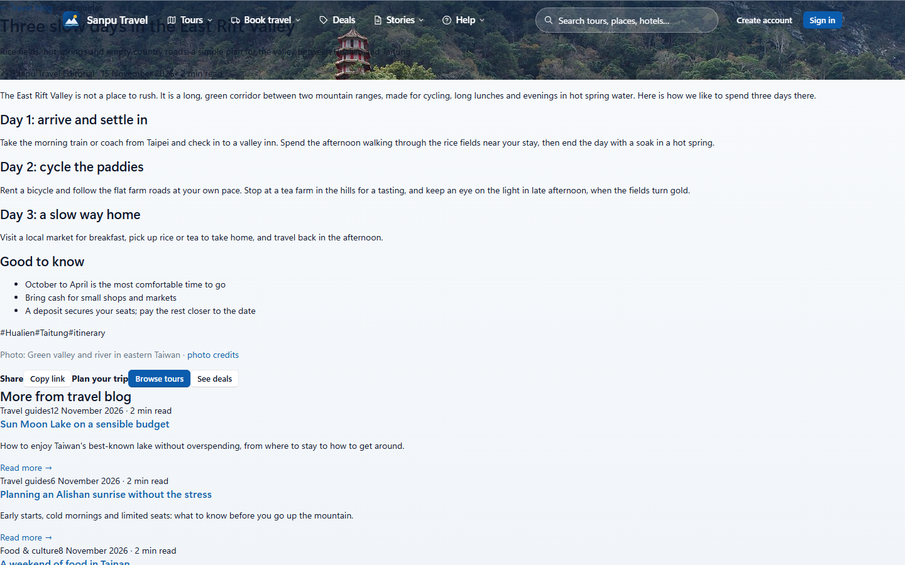

# Article page

App A · Sanpu Travel

| | |
|---|---|
| **Route** | `/blog/three-slow-days-in-the-east-rift-valley` |
| **Permission** |  |
| **Shown as** | anonymous visitor |
| **Area** | Customer |

## Purpose
Photo header, article body, tags, photo credit, share and related articles.

## API (Swagger: `/swagger`, tag in the OpenAPI document)
- `GET /api/v1/content/articles/{slug}`

## Stored procedures
- `usp_Article_GetPublic`

## States
Loading skeleton while data loads · empty state ("Nothing here yet.") · error box with the server's message, a **Retry** button and the **correlation ID** · 403 page when the role lacks the permission (the API refuses the same call).

## Automated tests
- Covered by the screenshot run (`tests/e2e/screens.spec.ts`) and manual checklist; no dedicated functional test yet.

## Presenter script (30 seconds)
As an anonymous visitor, open **Article page**. and point out that everything on screen comes from SQL Server through `GET /api/v1/content/articles/{slug}`. Mention the permission () is checked by the API, not only by hiding the menu, and that changes are written to the audit log.
