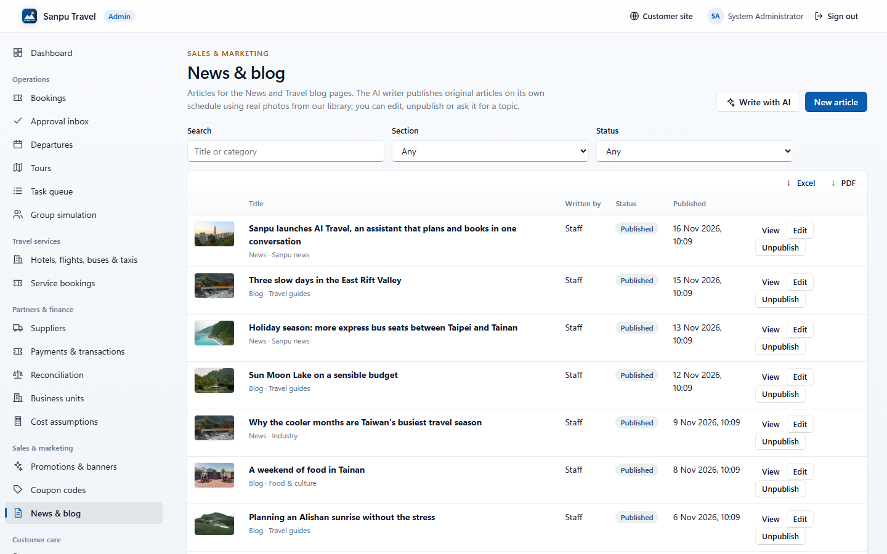

# News & blog (admin) and AI writer

App A · Sanpu Travel

| | |
|---|---|
| **Route** | `/admin/articles` |
| **Permission** |  |
| **Shown as** | `admin@demo.sanpu.test` (fictional demo account) |
| **Area** | Admin |

## Purpose
Edit, publish or unpublish articles; Write with AI asks the writer for an original article on a topic (or the next unused one) with a real photo from the library. The hourly bot publishes one news and one blog article per interval.

## API (Swagger: `/swagger`, tag in the OpenAPI document)
- `GET/POST/PUT /api/v1/ops/articles`
- `POST /api/v1/ops/articles/{id}/status`
- `POST /api/v1/ops/articles/write {kind, topic, publish}`

## Stored procedures
- `usp_Articles_Admin`
- `usp_Article_Save`
- `usp_Article_SetStatus`
- `usp_Articles_BotState`

## States
Loading skeleton while data loads · empty state ("Nothing here yet.") · error box with the server's message, a **Retry** button and the **correlation ID** · 403 page when the role lacks the permission (the API refuses the same call).

## Automated tests
- Covered by the screenshot run (`tests/e2e/screens.spec.ts`) and manual checklist; no dedicated functional test yet.

## Presenter script (30 seconds)
Signed in as admin, open **News & blog (admin) and AI writer**. and point out that everything on screen comes from SQL Server through `GET/POST/PUT /api/v1/ops/articles`. Mention the permission () is checked by the API, not only by hiding the menu, and that changes are written to the audit log.
