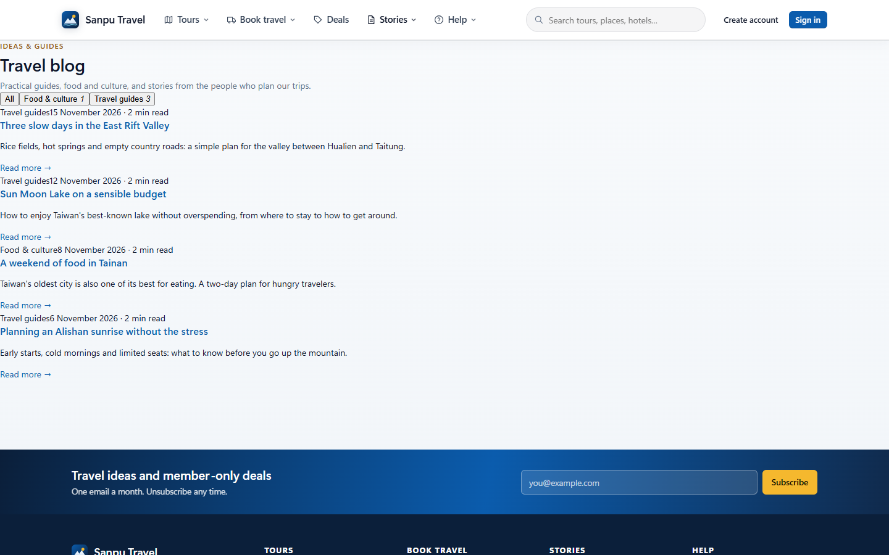

# Travel blog

App A · Sanpu Travel

| | |
|---|---|
| **Route** | `/blog` |
| **Permission** |  |
| **Shown as** | anonymous visitor |
| **Area** | Customer |

## Purpose
Guides, food and culture and Sanpu stories, written by staff or the AI writer in original words with real photos.

## API (Swagger: `/swagger`, tag in the OpenAPI document)
- `GET /api/v1/content/articles?kind=Blog&category&page`

## Stored procedures
- `usp_Articles_Public`

## States
Loading skeleton while data loads · empty state ("Nothing here yet.") · error box with the server's message, a **Retry** button and the **correlation ID** · 403 page when the role lacks the permission (the API refuses the same call).

## Automated tests
- Covered by the screenshot run (`tests/e2e/screens.spec.ts`) and manual checklist; no dedicated functional test yet.

## Presenter script (30 seconds)
As an anonymous visitor, open **Travel blog**. and point out that everything on screen comes from SQL Server through `GET /api/v1/content/articles?kind=Blog&category&page`. Mention the permission () is checked by the API, not only by hiding the menu, and that changes are written to the audit log.
