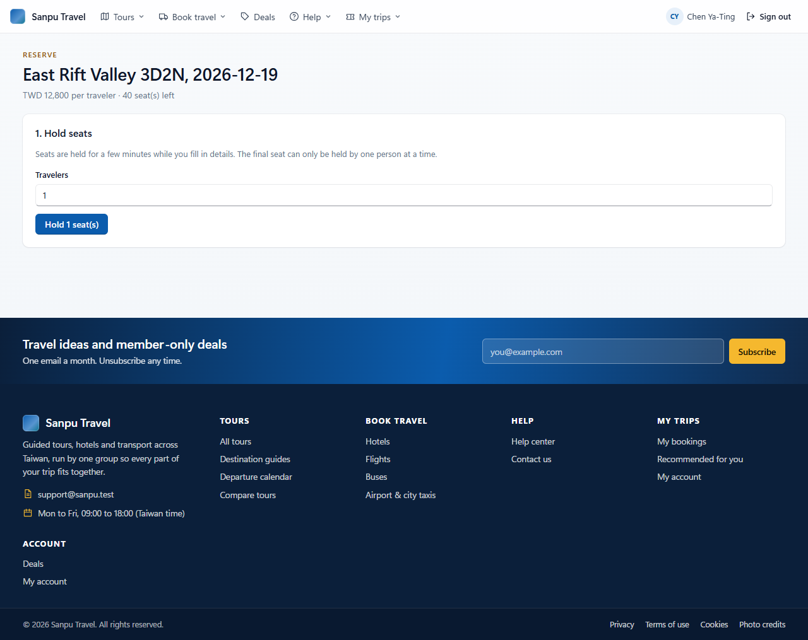

# Booking form

App A · Sanpu Travel

| | |
|---|---|
| **Route** | `/book/[departureId]` |
| **Permission** | Booking.Create (customer role) |
| **Shown as** | `traveler.chen@demo.sanpu.test` (fictional demo account) |
| **Area** | Customer |

## Purpose
Same idempotency key twice returns the first result, so a double click cannot make two bookings

## Fields and validation
| Field | Type | Rules (client hint + server validation + SQL constraint) |
|---|---|---|
| Travelers | number | 1 … seats left (re-checked in the proc) |
| Lead traveler name | text | required · 2–100 |
| Lead traveler phone | tel | required · E.164 · encrypted |
| Passport / ID no. | text | optional · encrypted · masked as A12••••89 |
| Special requests | textarea | max 1000 · stored as plain text (no HTML) |
| I accept the terms and privacy notice | checkbox | required |

## Actions
- **Hold seats (15 min)**
- **Confirm booking**

## API (Swagger: `/swagger`, tag in the OpenAPI document)
- `POST /api/v1/bookings/holds {departureId, pax, idempotencyKey} → 201 hold + expiresAt`
- `409 insufficient_capacity`
- `POST /api/v1/bookings {holdId,…} → 201 booking Pending approval`

## Stored procedures
- `usp_Booking_CreateHold (UPDLOCK, HOLDLOCK on the departure row: final-seat safe)`
- `usp_Booking_CreateFromHold`

## Rules, audit and security effects
- Same idempotency key twice returns the first result, so a double click cannot make two bookings

## States
Loading skeleton while data loads · empty state ("Nothing here yet.") · error box with the server's message, a **Retry** button and the **correlation ID** · 403 page when the role lacks the permission (the API refuses the same call).

## Automated tests
- `C01` customer books → ops approves → finance records payment → customer requests cancellation
- `C02` the final seat goes to exactly one of two simultaneous buyers

## Presenter script (30 seconds)
Signed in as traveler.chen, open **Booking form**. Click **Hold seats (15 min)** and point out that everything on screen comes from SQL Server through `POST /api/v1/bookings/holds`. Mention the permission (Booking.Create (customer role)) is checked by the API, not only by hiding the menu, and that changes are written to the audit log.
