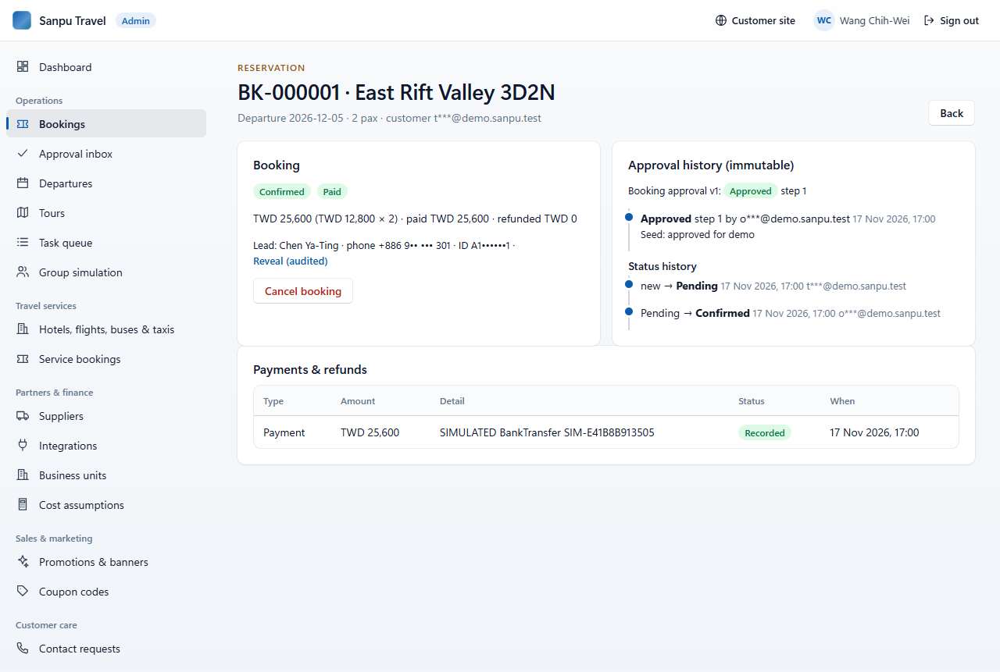

# Booking detail · approve / reject / cancel / refund

App A · Sanpu Travel

| | |
|---|---|
| **Route** | `/admin/bookings/1` |
| **Permission** | Booking.Approve · Booking.Cancel · Finance.Refund |
| **Shown as** | `ops.manager@demo.sanpu.test` (fictional demo account) |
| **Area** | Admin |

## Purpose
Separation of duties: whoever created the booking cannot approve it

## Fields and validation
| Field | Type | Rules (client hint + server validation + SQL constraint) |
|---|---|---|
| Decision comment | textarea | required on reject · max 500 |
| Refund amount (TWD) | money | 0 < amount ≤ paid − refunded |
| Refund reason | select | Customer request / Supplier cancel / Weather |
| Phone | masked | "Reveal" needs Pii.Reveal and writes an audit row |

## Actions
- **Approve**
- **Reject**
- **Cancel booking**
- **Issue refund (SIMULATED)**
- **Record payment (SIMULATED)**
- **Reveal PII**

## API (Swagger: `/swagger`, tag in the OpenAPI document)
- `POST /api/v1/ops/bookings/{id}/decision {decision: Approved|Rejected, comment}`
- `POST /api/v1/ops/bookings/{id}/cancel`
- `POST /api/v1/ops/bookings/{id}/refunds`
- `POST /api/v1/ops/bookings/{id}/payments`
- `POST /api/v1/ops/bookings/{id}/reveal-pii`

## Stored procedures
- `usp_Booking_Decide (state machine + approval step + capacity in one transaction)`
- `usp_Booking_Cancel (gives seats back)`
- `usp_Finance_CreateRefund`
- `usp_Finance_RecordPayment`

## Rules, audit and security effects
- Separation of duties: whoever created the booking cannot approve it
- Timeline of approval history (immutable)

## States
Loading skeleton while data loads · empty state ("Nothing here yet.") · error box with the server's message, a **Retry** button and the **correlation ID** · 403 page when the role lacks the permission (the API refuses the same call).

## Automated tests
- `C01` customer books → ops approves → finance records payment → customer requests cancellation

## Presenter script (30 seconds)
Signed in as ops.manager, open **Booking detail · approve / reject / cancel / refund**. Click **Approve** and point out that everything on screen comes from SQL Server through `POST /api/v1/ops/bookings/{id}/decision`. Mention the permission (Booking.Approve · Booking.Cancel · Finance.Refund) is checked by the API, not only by hiding the menu, and that changes are written to the audit log.
