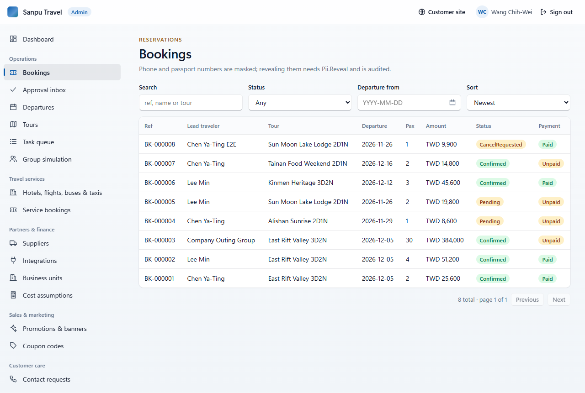

# Bookings

App A · Sanpu Travel

| | |
|---|---|
| **Route** | `/admin/bookings` |
| **Permission** | Booking.View |
| **Shown as** | `ops.manager@demo.sanpu.test` (fictional demo account) |
| **Area** | Admin |

## Purpose
RESERVATIONS

## Fields and validation
| Field | Type | Rules (client hint + server validation + SQL constraint) |
|---|---|---|
| Search | text | ref / lead name |
| Status | select | Pending/Confirmed/Rejected/CancelRequested/Cancelled/Refunded |
| Departure from | date |  |

## Actions
- **Open**

## API (Swagger: `/swagger`, tag in the OpenAPI document)
- `GET /api/v1/ops/bookings?search=&status=&page=&sort=`

## Stored procedures
- `usp_Ops_Bookings_List`

## States
Loading skeleton while data loads · empty state ("Nothing here yet.") · error box with the server's message, a **Retry** button and the **correlation ID** · 403 page when the role lacks the permission (the API refuses the same call).

## Automated tests
- `E02` empty and error states render; unknown pages 404

## Presenter script (30 seconds)
Signed in as ops.manager, open **Bookings**. Click **Open** and point out that everything on screen comes from SQL Server through `GET /api/v1/ops/bookings?search=&status=&page=&sort=`. Mention the permission (Booking.View) is checked by the API, not only by hiding the menu, and that changes are written to the audit log.
