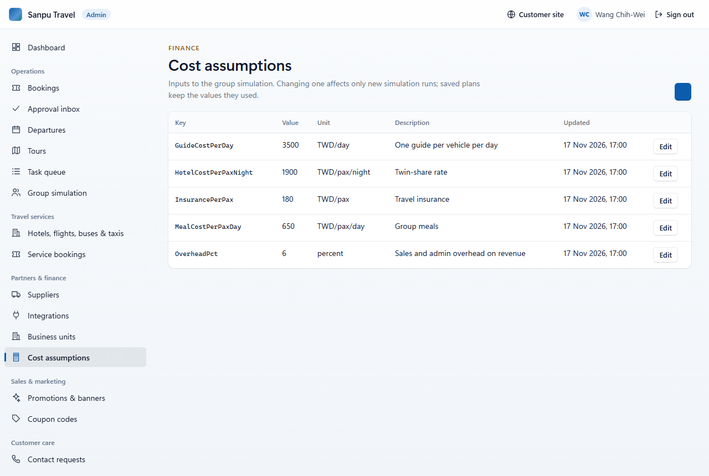

# Cost assumptions

App A · Sanpu Travel

| | |
|---|---|
| **Route** | `/admin/cost-assumptions` |
| **Permission** | CostAssumption.Edit |
| **Shown as** | `ops.manager@demo.sanpu.test` (fictional demo account) |
| **Area** | Admin |

## Purpose
Guide, meal, hotel, insurance and overhead rates used by the group simulation. Saved plans keep the values they used, so results stay reproducible.

## API (Swagger: `/swagger`, tag in the OpenAPI document)
- `GET /api/v1/ops/cost-assumptions`
- `PUT /api/v1/ops/cost-assumptions/{key}`

## Stored procedures
- `usp_Ops_CostAssumptions_List`
- `usp_Ops_CostAssumptions_Update`

## States
Loading skeleton while data loads · empty state ("Nothing here yet.") · error box with the server's message, a **Retry** button and the **correlation ID** · 403 page when the role lacks the permission (the API refuses the same call).

## Automated tests
- Covered by the screenshot run (`tests/e2e/screens.spec.ts`) and manual checklist; no dedicated functional test yet.

## Presenter script (30 seconds)
Signed in as ops.manager, open **Cost assumptions**. and point out that everything on screen comes from SQL Server through `GET /api/v1/ops/cost-assumptions`. Mention the permission (CostAssumption.Edit) is checked by the API, not only by hiding the menu, and that changes are written to the audit log.
