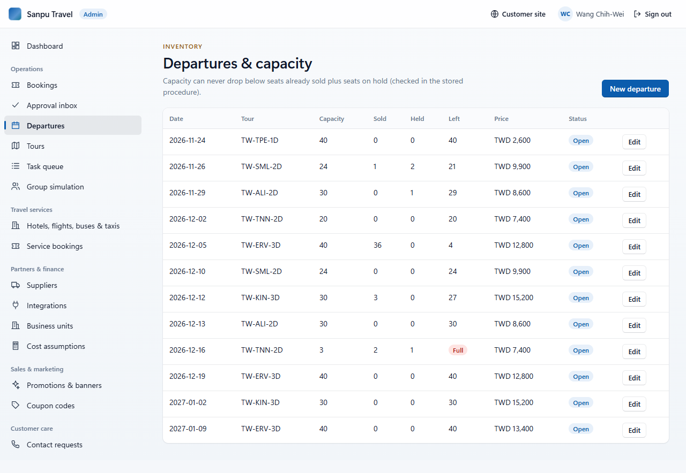

# Departures & capacity

App A · Sanpu Travel

| | |
|---|---|
| **Route** | `/admin/departures` |
| **Permission** | Departure.Edit |
| **Shown as** | `ops.manager@demo.sanpu.test` (fictional demo account) |
| **Area** | Admin |

## Purpose
INVENTORY

## Fields and validation
| Field | Type | Rules (client hint + server validation + SQL constraint) |
|---|---|---|
| Tour | select | required |
| Departure date | date | required · in the future |
| Capacity | number | 1–200 · cannot go below sold + held (proc check) |
| Price (TWD) | money | > 0 |
| Status | select | Open/Closed/Cancelled |

## Actions
- **New departure**
- **Save (status Open / Closed / Cancelled)**

## API (Swagger: `/swagger`, tag in the OpenAPI document)
- `GET/POST/PUT /api/v1/ops/departures`

## Stored procedures
- `usp_Ops_Departures_List`
- `usp_Ops_Departures_Upsert`

## States
Loading skeleton while data loads · empty state ("Nothing here yet.") · error box with the server's message, a **Retry** button and the **correlation ID** · 403 page when the role lacks the permission (the API refuses the same call).

## Automated tests
- Covered by the screenshot run (`tests/e2e/screens.spec.ts`) and manual checklist; no dedicated functional test yet.

## Presenter script (30 seconds)
Signed in as ops.manager, open **Departures & capacity**. Click **New departure** and point out that everything on screen comes from SQL Server through `GET/POST/PUT /api/v1/ops/departures`. Mention the permission (Departure.Edit) is checked by the API, not only by hiding the menu, and that changes are written to the audit log.
