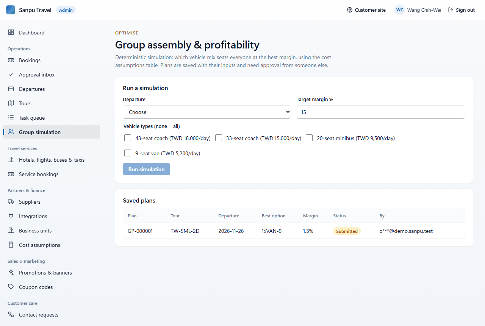

# Group assembly simulation

App A · Sanpu Travel

| | |
|---|---|
| **Route** | `/admin/group-sim` |
| **Permission** | GroupPlan.Simulate / GroupPlan.Approve |
| **Shown as** | `ops.manager@demo.sanpu.test` (fictional demo account) |
| **Area** | Admin |

## Purpose
Maths in Domain (GroupPlanner), unit tested; results saved for reproducibility

## Fields and validation
| Field | Type | Rules (client hint + server validation + SQL constraint) |
|---|---|---|
| Departure | select | required |
| Vehicle options | multi-select | from Vehicles table |
| Guide cost / day | money | ≥ 0 (cost assumption row) |
| Target margin % | number | 0–80 |

## Actions
- **Run simulation**
- **Submit plan for approval**

## API (Swagger: `/swagger`, tag in the OpenAPI document)
- `POST /api/v1/ops/group-sim/run`
- `POST /api/v1/ops/group-sim/{id}/submit`
- `approval itself: POST /api/v1/ops/approvals/{id}/act (by another user)`

## Stored procedures
- `usp_GroupSim_Inputs`
- `usp_GroupSim_Save`
- `usp_GroupSim_Submit`
- `usp_Approval_Act`

## Rules, audit and security effects
- Maths in Domain (GroupPlanner), unit tested; results saved for reproducibility

## States
Loading skeleton while data loads · empty state ("Nothing here yet.") · error box with the server's message, a **Retry** button and the **correlation ID** · 403 page when the role lacks the permission (the API refuses the same call).

## Automated tests
- `D04` group simulation saves a draft plan and needs another approver

## Presenter script (30 seconds)
Signed in as ops.manager, open **Group assembly simulation**. Click **Run simulation** and point out that everything on screen comes from SQL Server through `POST /api/v1/ops/group-sim/run`. Mention the permission (GroupPlan.Simulate / GroupPlan.Approve) is checked by the API, not only by hiding the menu, and that changes are written to the audit log.
