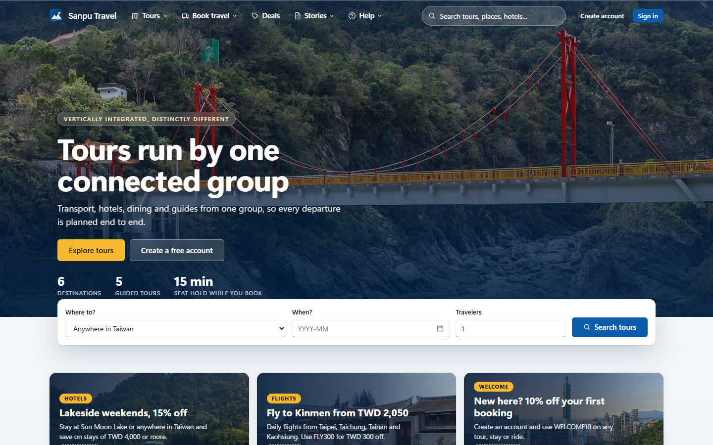

# Tour catalog (customer home)

App A · Sanpu Travel

| | |
|---|---|
| **Route** | `/` |
| **Permission** | public (booking needs sign-in) |
| **Shown as** | anonymous visitor |
| **Area** | Customer |

## Purpose
Hero tagline + sections come from ContentTemplates

## Fields and validation
| Field | Type | Rules (client hint + server validation + SQL constraint) |
|---|---|---|
| Destination | select | from Destinations table |
| Month | month | ≥ this month |
| Travelers | number | 1–20 |

## Actions
- **Search tours**

## API (Swagger: `/swagger`, tag in the OpenAPI document)
- `GET /api/v1/catalog/tours?destination=&month=&pax=`

## Stored procedures
- `usp_Catalog_SearchTours`

## Rules, audit and security effects
- Hero tagline + sections come from ContentTemplates
- Every tour shows the DEMO / FICTIONAL badge

## States
Loading skeleton while data loads · empty state ("Nothing here yet.") · error box with the server's message, a **Retry** button and the **correlation ID** · 403 page when the role lacks the permission (the API refuses the same call).

## Automated tests
- `B03` settings change reaches the public site without a rebuild
- `E01` responsive: no sideways scrolling on phone width; labelled controls

## Presenter script (30 seconds)
As an anonymous visitor, open **Tour catalog (customer home)**. Click **Search tours** and point out that everything on screen comes from SQL Server through `GET /api/v1/catalog/tours?destination=&month=&pax=`. Mention the permission (public (booking needs sign-in)) is checked by the API, not only by hiding the menu, and that changes are written to the audit log.
