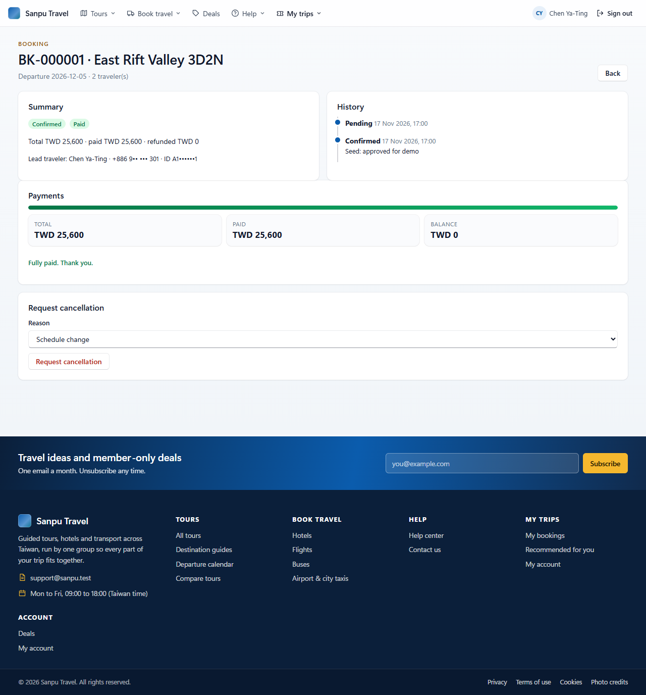

# My booking detail & cancellation

App A · Sanpu Travel

| | |
|---|---|
| **Route** | `/my/bookings/1` |
| **Permission** | Booking.ViewOwn (own bookings only; other ids return 404) |
| **Shown as** | `traveler.chen@demo.sanpu.test` (fictional demo account) |
| **Area** | Customer |

## Purpose
Customer view of one booking: status, payment, masked contact data, history timeline, and the withdraw / request-cancellation action.

## API (Swagger: `/swagger`, tag in the OpenAPI document)
- `GET /api/v1/my/bookings/{id}`
- `POST /api/v1/my/bookings/{id}/cancel`

## Stored procedures
- `usp_Booking_GetForCustomer`
- `usp_Booking_RequestCancel`

## States
Loading skeleton while data loads · empty state ("Nothing here yet.") · error box with the server's message, a **Retry** button and the **correlation ID** · 403 page when the role lacks the permission (the API refuses the same call).

## Automated tests
- `C01` customer books → ops approves → finance records payment → customer requests cancellation

## Presenter script (30 seconds)
Signed in as traveler.chen, open **My booking detail & cancellation**. and point out that everything on screen comes from SQL Server through `GET /api/v1/my/bookings/{id}`. Mention the permission (Booking.ViewOwn (own bookings only; other ids return 404)) is checked by the API, not only by hiding the menu, and that changes are written to the audit log.
