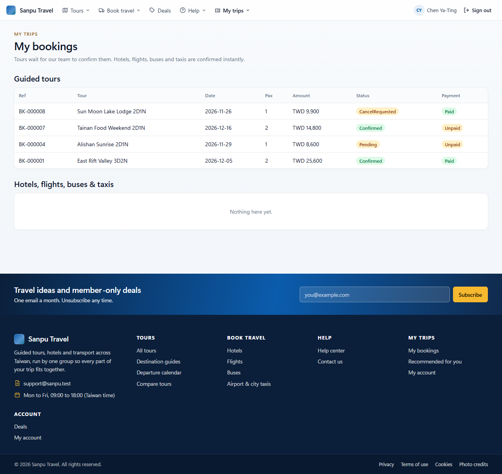

# My bookings

App A · Sanpu Travel

| | |
|---|---|
| **Route** | `/my/bookings` |
| **Permission** | Booking.ViewOwn |
| **Shown as** | `traveler.chen@demo.sanpu.test` (fictional demo account) |
| **Area** | Customer |

## Purpose
Asking for someone else's booking ID returns 404, not 403

## Fields and validation
| Field | Type | Rules (client hint + server validation + SQL constraint) |
|---|---|---|
| Cancel reason | select + text | required on cancel |

## Actions
- **View**
- **Request cancellation**

## API (Swagger: `/swagger`, tag in the OpenAPI document)
- `GET /api/v1/my/bookings`
- `POST /api/v1/my/bookings/{id}/cancel`

## Stored procedures
- `usp_Booking_ListForCustomer (scoped to the caller: no IDOR)`
- `usp_Booking_RequestCancel`

## Rules, audit and security effects
- Asking for someone else's booking ID returns 404, not 403

## States
Loading skeleton while data loads · empty state ("Nothing here yet.") · error box with the server's message, a **Retry** button and the **correlation ID** · 403 page when the role lacks the permission (the API refuses the same call).

## Automated tests
- `C01` customer books → ops approves → finance records payment → customer requests cancellation
- `C03` no IDOR, no privilege escalation, no forged tokens

## Presenter script (30 seconds)
Signed in as traveler.chen, open **My bookings**. Click **View** and point out that everything on screen comes from SQL Server through `GET /api/v1/my/bookings`. Mention the permission (Booking.ViewOwn) is checked by the API, not only by hiding the menu, and that changes are written to the audit log.
