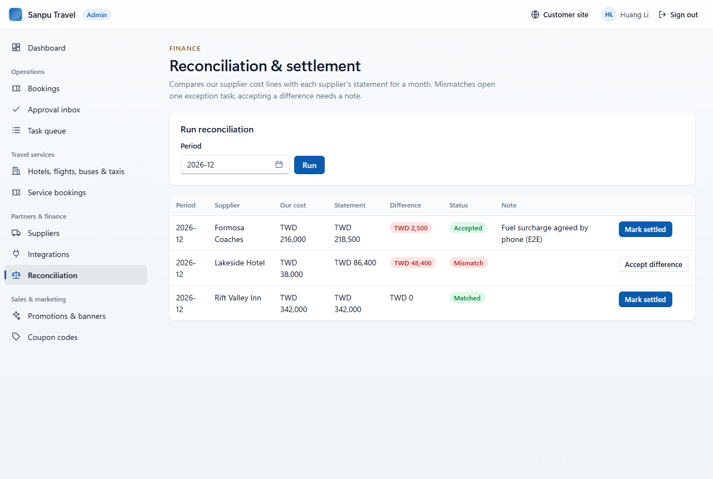

# Reconciliation & settlement

App A · Sanpu Travel

| | |
|---|---|
| **Route** | `/admin/reconciliation` |
| **Permission** | Finance.Reconcile |
| **Shown as** | `finance@demo.sanpu.test` (fictional demo account) |
| **Area** | Admin |

## Purpose
FINANCE

## Fields and validation
| Field | Type | Rules (client hint + server validation + SQL constraint) |
|---|---|---|
| Period | month | required |
| Resolution note | textarea | required to accept a mismatch |

## Actions
- **Run reconciliation**
- **Accept difference**
- **Mark settled**

## API (Swagger: `/swagger`, tag in the OpenAPI document)
- `POST /api/v1/ops/reconciliation/run`
- `POST /api/v1/ops/reconciliation/{id}/resolve`

## Stored procedures
- `usp_Recon_Run`
- `usp_Recon_Resolve`

## States
Loading skeleton while data loads · empty state ("Nothing here yet.") · error box with the server's message, a **Retry** button and the **correlation ID** · 403 page when the role lacks the permission (the API refuses the same call).

## Automated tests
- `D03` reconciliation finds the seeded mismatch; accepting it needs a note

## Presenter script (30 seconds)
Signed in as finance, open **Reconciliation & settlement**. Click **Run reconciliation** and point out that everything on screen comes from SQL Server through `POST /api/v1/ops/reconciliation/run`. Mention the permission (Finance.Reconcile) is checked by the API, not only by hiding the menu, and that changes are written to the audit log.
