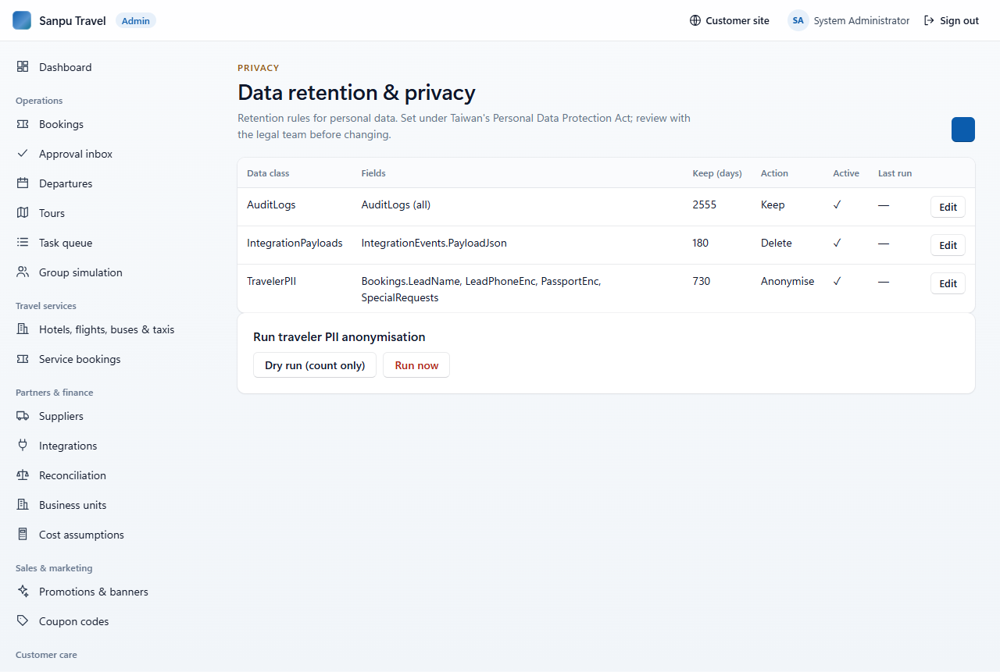

# Data retention & privacy

App A · Sanpu Travel

| | |
|---|---|
| **Route** | `/admin/privacy` |
| **Permission** | Privacy.Manage |
| **Shown as** | `admin@demo.sanpu.test` (fictional demo account) |
| **Area** | Admin |

## Purpose
Taiwan PDPA: legal review needed before production use

## Fields and validation
| Field | Type | Rules (client hint + server validation + SQL constraint) |
|---|---|---|
| Keep (days) | number | 30–3650 |
| Action | select | Anonymise / Delete |

## Actions
- **Save policy**
- **Run dry-run**
- **Run now**

## API (Swagger: `/swagger`, tag in the OpenAPI document)
- `GET/PUT /api/v1/ops/privacy/policies`
- `POST /api/v1/ops/privacy/run?dryRun=`

## Stored procedures
- `usp_Privacy_Policies`
- `usp_Privacy_Run`

## Rules, audit and security effects
- Taiwan PDPA: legal review needed before production use

## States
Loading skeleton while data loads · empty state ("Nothing here yet.") · error box with the server's message, a **Retry** button and the **correlation ID** · 403 page when the role lacks the permission (the API refuses the same call).

## Automated tests
- Covered by the screenshot run (`tests/e2e/screens.spec.ts`) and manual checklist; no dedicated functional test yet.

## Presenter script (30 seconds)
Signed in as admin, open **Data retention & privacy**. Click **Save policy** and point out that everything on screen comes from SQL Server through `GET/PUT /api/v1/ops/privacy/policies`. Mention the permission (Privacy.Manage) is checked by the API, not only by hiding the menu, and that changes are written to the audit log.
